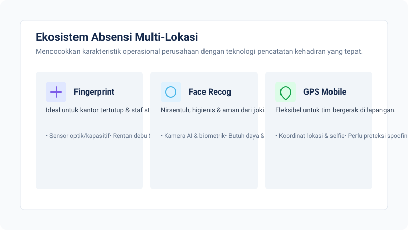
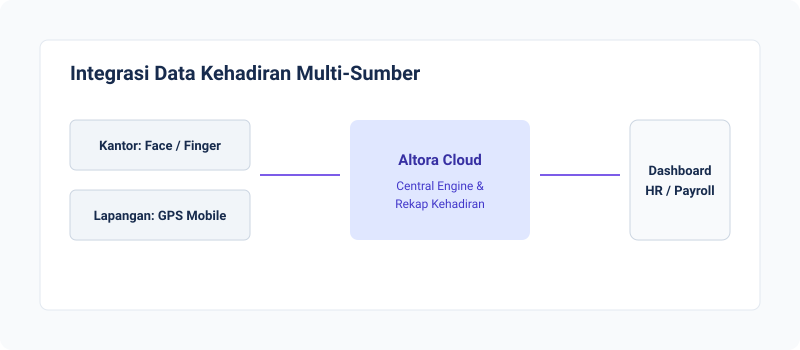

Absensi untuk tim lapangan sering berhenti di pertanyaan yang keliru: mana teknologi paling canggih? Pertanyaan yang lebih berguna adalah bukti kehadiran seperti apa yang benar-benar dibutuhkan agar pekerjaan berjalan tertib. Tim penjualan, teknisi, pengawas proyek, dan kru pengiriman tidak selalu memulai hari dari kantor. Di Kalimantan Timur, titik kerja yang tersebar antarkota dan antarkabupaten membuat hal ini semakin nyata. Mereka bergerak, bertemu pelanggan, atau bekerja di beberapa titik.

Karena itu, sistem absensi perlu mengikuti cara kerja, bukan memaksa orang mengubah pekerjaan hanya demi menekan tombol hadir. Catatan jam masuk dan pulang memang penting, tetapi konteks lokasi, identitas, proses persetujuan, serta penanganan kesalahan juga sama pentingnya. Pilihan antara GPS, pengenalan wajah, dan fingerprint sebaiknya dibuat setelah kebutuhan tersebut jelas.

Artikel ini membantu Anda membandingkan tiga pendekatan itu secara praktis. Tujuannya bukan mencari satu pemenang untuk semua bisnis, melainkan memilih sistem yang paling masuk akal untuk tim Anda.

## Mulai dari alur kerja, bukan dari perangkat

Sebelum memilih metode, petakan kegiatan sehari-hari tim. Tanyakan di mana mereka memulai dan mengakhiri shift, apakah lokasi kerja tetap atau berpindah, siapa yang memeriksa catatan, serta apa yang dilakukan saat ada data yang tidak sesuai. Jawaban ini menentukan apakah Anda membutuhkan bukti lokasi, bukti identitas, atau keduanya.

Tuliskan juga aturan yang mudah dipahami. Misalnya, apakah kehadiran harus tercatat sebelum memasuki lokasi, apakah ada toleransi untuk pekerjaan di area dengan sinyal lemah, dan kapan atasan boleh menyetujui koreksi. Sistem yang baik tetap membutuhkan kebijakan yang jelas; teknologi tidak otomatis menyelesaikan perselisihan tanpa proses pemeriksaan.

Untuk tim yang tersebar, absensi dapat dihubungkan dengan tugas, cuti, dan persetujuan dalam [Altora Teams](/aplikasi/teams). Dengan begitu, atasan tidak hanya melihat siapa yang hadir, tetapi juga dapat membandingkan catatan kehadiran dengan penugasan yang memang direncanakan.

## Absensi GPS untuk tim yang berpindah lokasi

Absensi GPS mencatat posisi perangkat saat karyawan melakukan check-in atau check-out. Pendekatan ini cocok ketika pekerjaan memang berlangsung di banyak lokasi, seperti kunjungan sales, servis teknisi, inspeksi, atau pengawasan proyek. Manfaat utamanya adalah memberi konteks apakah pencatatan dibuat dari area kerja yang dituju.

Namun GPS bukan bukti mutlak bahwa seseorang bekerja sepanjang waktu di titik tersebut. Ketelitian lokasi dapat berubah karena bangunan, cuaca, ketersediaan sinyal, pengaturan perangkat, dan lingkungan sekitar. Titik yang bergeser sedikit bukan selalu tanda pelanggaran. Karena itu, jangan membuat aturan yang terlalu kaku hanya berdasarkan satu catatan koordinat.

GPS lebih berguna bila dipadukan dengan batas area yang wajar dan alur peninjauan oleh atasan. Saat catatan berada di luar area, sistem dapat menandainya untuk diperiksa, bukan langsung menyimpulkan kesalahan. Beberapa aplikasi juga meminta swafoto sebagai bukti tambahan, serta memeriksa waktu dari server dan tanda lokasi tiruan (*fake GPS*); tanyakan pengamanan apa yang tersedia. Pastikan pula karyawan memahami kapan lokasi dicatat, untuk tujuan apa, dan siapa yang boleh mengakses datanya. Pendekatan terbuka mengurangi salah paham serta menjaga kepercayaan tim.

## Absensi wajah untuk titik kerja tetap

Absensi wajah membandingkan wajah orang yang hadir dengan data yang telah didaftarkan dalam sistem. Metode ini biasanya paling relevan bila tim berkumpul di titik tetap, misalnya kantor cabang, base camp, gerbang proyek, atau area operasional. Nilai utamanya adalah membantu memeriksa identitas orang yang melakukan absensi tanpa kartu atau sidik jari.

Sebelum menerapkannya, perhatikan kondisi nyata di lokasi. Pencahayaan, posisi kamera, antrean saat pergantian shift, akses listrik, dan jalur ketika wajah tidak dapat dikenali perlu diuji terlebih dahulu. Proses cadangan harus tersedia agar karyawan yang sah tidak tertahan hanya karena kondisi kamera atau perubahan penampilan.

Keunggulan lain dari absensi wajah adalah prosesnya nirsentuh, sehingga tidak ada permukaan yang disentuh bergantian. Absensi wajah juga bukan pengganti pengelolaan manusia. Petugas atau atasan tetap perlu memiliki wewenang terbatas untuk meninjau pengecualian. Akses data wajah dan riwayat kehadiran perlu dibatasi pada pihak yang memang bertugas. Pilih solusi yang menjelaskan cara pendaftaran, pembaruan data, dan penghapusan data sesuai kebutuhan operasional Anda.

Sebagai gambaran, lihat contoh [absensi face recognition](/portofolio/smart-attendance-unmul) dan [HRIS mobile dengan absensi dan payroll](/portofolio/hris-mobile-payroll) di portofolio kami.

## Fingerprint untuk kebiasaan hadir di satu tempat

Fingerprint masih relevan untuk kantor, gudang, toko, kantin, atau operasi lain dengan titik hadir tetap. Alurnya sederhana: karyawan datang ke perangkat, melakukan verifikasi, lalu catatan tersimpan. Bagi organisasi yang sudah terbiasa dengan mesin absensi di pintu masuk, perubahan proses biasanya lebih kecil.

Batasannya jelas untuk tim lapangan. Perangkat berada di satu lokasi, sehingga kru yang bekerja jauh dari mesin akan kesulitan mencatat kehadiran tepat waktu. Perangkat juga perlu dijaga, dibersihkan, mendapat pasokan listrik, dan memiliki prosedur ketika jaringan bermasalah. Debu, oli, atau jari yang aus akibat pekerjaan fisik juga dapat membuat sensor sulit membaca, sehingga area tambang, konstruksi, atau perkebunan perlu diuji dahulu. Jangan memilih fingerprint bila mayoritas pekerjaan justru terjadi di luar titik tersebut.

Metode ini tepat bila masalah utama Anda adalah penertiban jam hadir di lokasi yang tetap, bukan pelacakan aktivitas saat karyawan bergerak. Untuk bisnis dengan gudang sekaligus tim pengantaran, fingerprint dapat dipakai di gudang sementara metode lain digunakan bagi staf bergerak.

## Kombinasi sering lebih realistis daripada satu metode

Tidak semua unit perlu memakai cara yang sama. Kantor pusat dapat memakai wajah atau fingerprint, sedangkan teknisi dan sales memakai GPS. Yang penting, definisi jam kerja, izin, lembur, koreksi data, dan peran penyetuju tetap konsisten di seluruh unit.

Hindari membangun proses yang memaksa karyawan melakukan beberapa absensi tanpa alasan yang kuat. Setiap langkah tambahan meningkatkan risiko lupa, antre, atau data ganda. Mulailah dari bukti minimum yang diperlukan, lalu tambah verifikasi hanya pada titik yang memang berisiko.

Uji alur pada satu tim atau satu lokasi terlebih dahulu. Amati apakah staf memahami proses, apakah atasan mampu meninjau pengecualian, dan apakah catatan yang dihasilkan benar-benar membantu keputusan shift atau penggajian. Dari sana, Anda dapat memperbaiki aturan sebelum diterapkan lebih luas.

## Area tanpa sinyal dan kesiapan tim

Di kebun, tambang, atau basecamp terpencil, koneksi dapat hilang. Tanyakan apakah aplikasi atau perangkat menyimpan catatan secara lokal lalu mengirimnya setelah koneksi kembali (*mode offline*), serta bagaimana waktu kejadian divalidasi. Siapkan juga paket data, tempat mengisi daya, dan sosialisasi yang jelas: karyawan perlu tahu bahwa data lokasi atau wajah dipakai untuk memastikan jam kerja, lembur, dan tunjangan dihitung adil, bukan untuk mengawasi di luar kebutuhan kerja. Penolakan awal sering muncul karena kekhawatiran privasi yang belum dijawab.

## Checklist memilih sistem absensi

1. Tentukan apakah Anda terutama perlu bukti lokasi, bukti identitas, atau kombinasi keduanya.
2. Petakan titik kerja tetap dan rute tim yang berpindah.
3. Buat aturan koreksi data, izin, dan persetujuan atasan sebelum sistem digunakan.
4. Siapkan jalur cadangan untuk sinyal, listrik, kamera, atau perangkat yang bermasalah.
5. Batasi akses data absensi hanya kepada pihak yang menjalankan fungsi terkait.
6. Jalankan uji coba kecil, lalu ukur apakah alur lebih tertib tanpa menghambat pekerjaan.

Absensi terbaik bukan yang paling rumit, melainkan yang memberi catatan cukup andal sambil tetap menghormati ritme kerja tim. Jika Anda ingin memetakan kebutuhan absensi tim lapangan dan menyusun alur yang sesuai, [hubungi Altora](/contact).
