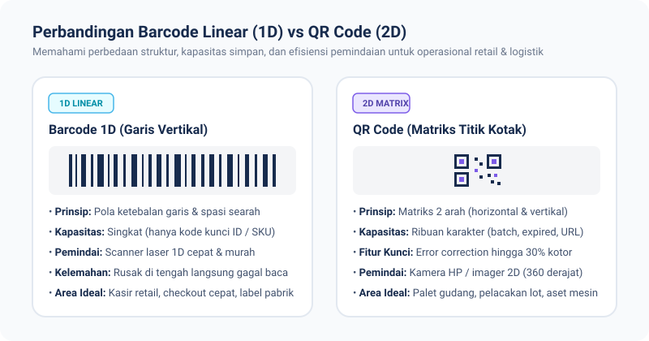
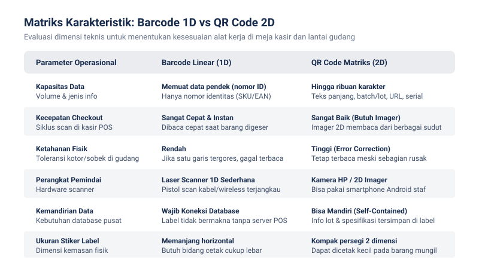

Aktivitas meja kasir saat jam sibuk dan bongkar muat barang di gudang adalah dua titik krusial penentu kelancaran bisnis. Ketika antrean pelanggan mulai memanjang, kasir dituntut memindai belanjaan secepat mungkin tanpa kesalahan harga. Di saat yang sama, tim gudang memerlukan cara praktis mencatat penerimaan ratusan dus barang tanpa harus menuliskan kode serial satu demi satu.

Bagi pemilik usaha retail, grosir, maupun distribusi di Kalimantan Timur, label pemindai otomatis menjadi fondasi penting digitalisasi operasional. Namun, muncul keraguan umum: apakah operasional toko cukup memakai barcode garis biasa (1D), atau sebaiknya langsung beralih ke QR code kotak (2D) yang terlihat lebih modern?

Sebagian pengelola mengira QR code selalu lebih baik di semua situasi. Di sisi lain, ada yang ragu beralih karena khawatir seluruh perangkat scanner harus diganti. Dalam praktiknya, kedua teknologi ini memiliki peran berbeda yang saling melengkapi, dan keduanya dapat dihubungkan ke sistem kasir dan stok seperti [Altora Store](/aplikasi/store). Artikel ini mengupas perbandingan teknis, kelebihan, batas penggunaan, serta panduan memilih format yang paling efisien bagi usaha Anda.

## Mengenal anatomi dasar: Barcode 1D dan QR Code 2D

Sebelum memilih jenis label untuk toko atau gudang Anda, mari pahami perbedaan cara kerja kedua teknologi identifikasi ini.

Barcode linear atau barcode satu dimensi (1D) tersusun dari garis-garis vertikal hitam dengan ketebalan dan jarak spasi berbeda. Informasi di dalamnya dibaca secara horizontal dari kiri ke kanan. Standar ini sudah puluhan tahun digunakan di industri ritel global, seperti kode EAN-13 pada produk konsumen atau Code 128 pada paket kargo. Barcode 1D hanya berfungsi sebagai penunjuk unik (*key identifier*), umumnya berisi deret angka identitas barang di pangkalan data.

Sebaliknya, QR code (*Quick Response Code*) adalah barcode dua dimensi (2D) yang menyimpan data dalam matriks kotak hitam-putih secara horizontal maupun vertikal. QR code diciptakan pada 1994 oleh Denso Wave untuk melacak suku cadang otomotif dan dapat dibaca dari berbagai sudut. Karena datanya tersusun dua dimensi, QR code dapat menyimpan jauh lebih banyak data dibanding barcode garis pada luasan cetak yang sama.

## Perbandingan teknis: Barcode 1D vs QR Code 2D

Untuk membantu Anda menentukan alat kerja yang tepat, berikut perbandingan karakteristik teknis yang berdampak langsung pada operasional harian:

- **Kapasitas dan jenis data:** Barcode 1D umumnya hanya memuat kode pendek yang merujuk pada nomor ID di database. Sebaliknya, QR code mampu menampung ribuan karakter teks, tautan situs, tanggal kedaluwarsa, serta nomor *batch* produksi langsung di dalam stiker label.
- **Kecepatan pemindaian di kasir:** Barcode 1D unggul untuk transaksi cepat. Scanner kasir dapat membaca garis dengan cepat saat barang digeser. QR code dibaca oleh sensor citra (*2D imager*) yang mengambil gambar terlebih dahulu, sehingga pada perangkat sederhana dapat terasa sedikit lebih lambat.
- **Ketahanan terhadap kerusakan fisik:** Barcode 1D sangat rentan cacat fisik; bila garis tergores atau terpotong noda, pemindai gagal membacanya. Berbeda dengan itu, QR code memiliki koreksi kesalahan bawaan sehingga dapat tetap terbaca meski sebagian permukaannya kotor atau sobek, selama kerusakan tidak melebihi tingkat koreksi yang dipilih saat label dibuat.
- **Perangkat scanner:** Pemindai laser 1D umum dipakai dan awet untuk kasir. Untuk QR code, staf gudang dapat memakai kamera ponsel pintar (*smartphone*) Android sebagai alternatif scanner khusus, selama kebijakan penggunaan perangkat pribadi sudah jelas.

## Kapan bisnis Anda harus memilih Barcode 1D?

Barcode konvensional tetap menjadi standar terbaik untuk meja kasir toko retail, minimarket, apotek, dan toko kelontong modern. Format ini tepat digunakan bila:

1. **Prioritas utama adalah kecepatan transaksi checkout:** Saat melayani antrean belanja yang padat, kasir cukup menggeser kemasan di depan scanner laser tanpa perlu memosisikan sudut kemasan secara presisi.
2. **Menjual barang kemasan pabrik (FMCG):** Sebagian besar produk makanan, minuman, dan kebutuhan harian dari distributor sudah memuat barcode EAN-13 resmi di kemasannya. Anda tinggal mendaftarkan kode tersebut ke katalog POS tanpa mencetak stiker baru.
3. **Perangkat sederhana sudah cukup:** Scanner berkabel 1D mudah didapat dan mudah diganti jika rusak.

Batas penggunaan: Barcode 1D tidak dapat berdiri sendiri tanpa koneksi ke server atau database POS lokal, karena garis barcode hanya menyimpan angka acak tanpa nama atau harga barang.

## Kapan QR Code 2D menjadi solusi yang lebih ideal?

QR code menjadi pilihan unggulan di area gudang, logistik grosir, dan pengelolaan aset internal. Gunakan QR code apabila menghadapi kondisi berikut:

1. **Area gudang berdebu, lembap, atau rawan gesekan:** Pada gudang material bangunan atau bengkel mesin, label palet rawan kotor dan lecek. Berkat fitur *error correction*, QR code tetap terbaca lancar oleh pemindai.
2. **Kebutuhan pelacakan nomor batch dan kedaluwarsa:** Untuk makanan olahan atau farmasi yang memiliki masa simpan beragam (*lot tracking*), informasi kedaluwarsa dapat disematkan langsung di QR code tanpa membuat kode barang baru di sistem.
3. **Pemanfaatan smartphone staf (*BYOD*):** Petugas gudang dapat menggunakan ponsel Android mereka sendiri untuk melakukan *stock opname* dan mutasi stok tanpa investasi terminal scanner khusus.
4. **Ukuran kemasan sangat kecil:** Untuk barang mungil seperti baut, komponen elektronik, atau aksesoris, QR code dapat dicetak dalam dimensi bujur sangkar yang sangat ringkas.

Batas penggunaan: QR code kurang cocok dijadikan label utama di kasir retail bersirkulasi tinggi jika kasir hanya mengandalkan pemindaian kamera ponsel yang lambat.

## Strategi kombinasi (Hybrid): Solusi terpadu untuk UMKM

Anda tidak harus membatasi diri pada satu teknologi. Strategi paling efektif untuk bisnis berkembang adalah pendekatan kombinasi (*hybrid*):

- **Di Meja Kasir:** Gunakan barcode 1D pada setiap satuan barang untuk mempertahankan kecepatan layanan kasir tertinggi.
- **Di Kardus dan Palet Gudang:** Cetak label QR code 2D pada kemasan dus luar atau palet pengiriman. QR code memuat informasi nomor surat jalan, jumlah isi, dan tanggal masuk, sehingga staf gudang cukup memindai satu kali untuk mencatat puluhan barang sekaligus.

Sinergi ini memberi Anda kecepatan checkout di depan dan kelengkapan data inventaris di belakang.

## 4 langkah praktis menerapkan sistem label terpadu

Berikut tahapan sistematis untuk menerapkan standarisasi label di toko dan gudang Anda:

1. **Petakan kebutuhan tiap titik kerja:** Bedakan zona yang membutuhkan kecepatan tinggi (kasir) dengan zona yang memerlukan fleksibilitas data (gudang).
2. **Standarisasi kode penomoran SKU:** Susun format kode barang yang terstruktur dan hindari simbol khusus yang membingungkan pemindai lama.
3. **Gunakan printer dan label yang tepat:** Gunakan stiker *thermal transfer* tahan minyak untuk area gudang, serta stiker standar untuk produk etalase.
4. **Latih staf operasional:** Ajarkan staf teknik pemindaian yang efisien serta prosedur alternatif pengetikan manual bila label barang mengalami kerusakan parah.

Label yang konsisten membantu menekan selisih stok dan mempercepat pelayanan kasir, selama proses penerimaan dan pencatatan barang juga tertib. Untuk konteks yang lebih luas, baca [tanda bisnis perlu sistem POS](/blog/tanda-bisnis-perlu-pos). Untuk merancang alur kasir dan manajemen gudang yang sesuai dengan karakter usaha Anda, diskusikan langsung bersama tim kami melalui [halaman kontak Altora](/contact).
