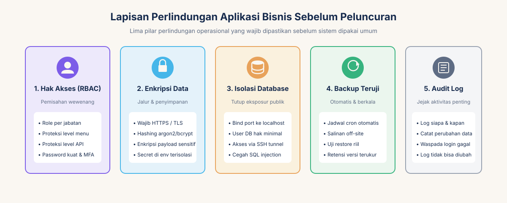
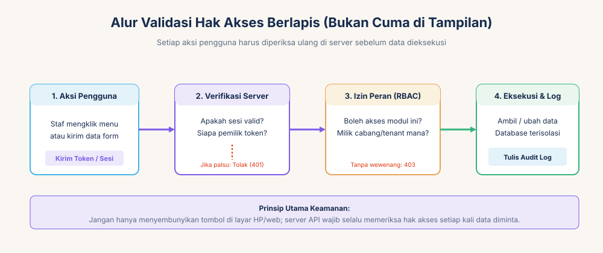
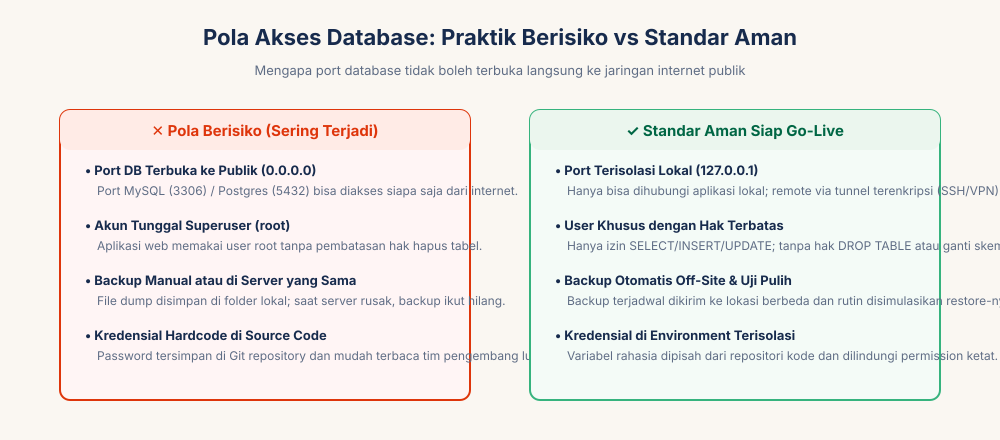
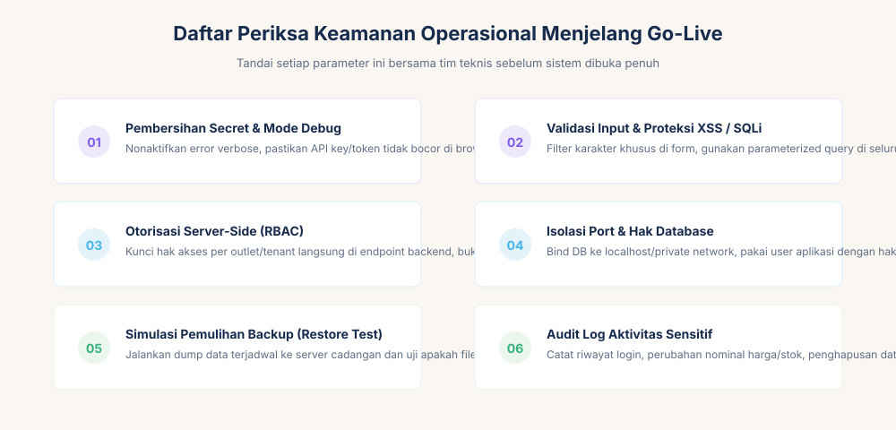

Momen menjelang peluncuran sistem baru selalu diwarnai antusiasme tinggi. Tim operasional sudah bersiap meninggalkan pencatatan manual, sementara manajemen menantikan laporan penjualan atau stok yang rapi secara otomatis. Namun, di tengah kesibukan menguji alur kerja sehari-hari, ada satu pertanyaan mendasar yang kerap terlewatkan: apakah aplikasi Anda sudah benar-benar aman saat dibuka untuk operasional penuh?

Bagi pemilik bisnis maupun manajer operasional, keamanan perangkat lunak sering kali terdengar seperti urusan teknis yang rumit. Padahal, insiden keamanan di lapangan jarang bermula dari serangan peretas canggih di film fiksi. Kerugian operasional sering terjadi karena celah mendasar yang lupa ditutup: port pangkalan data yang terbuka bebas ke internet publik, staf biasa yang bisa melihat data sensitif manajemen, atau transaksi yang hilang tanpa bisa dipulihkan karena file backup ternyata rusak sejak lama.

Saat merancang aplikasi lewat [layanan software custom](/services/software-custom) maupun [aplikasi buatan Altora](/aplikasi), kami memperlakukan tinjauan keamanan sebagai bagian dari persiapan peluncuran. Artikel ini merangkum checklist praktis yang dapat Anda pakai saat berdiskusi dengan vendor pengembang atau tim internal sebelum sistem diresmikan. Checklist ini adalah panduan umum, bukan audit keamanan formal.

## 1. Pembatasan hak akses berbasis peran (RBAC)

Prinsip dasar keamanan aplikasi operasional adalah membatasi wewenang setiap orang sesuai tanggung jawab pekerjaannya (*Role-Based Access Control* atau RBAC). Kasir di toko tidak perlu mengakses laporan laba rugi bulanan, staf gudang cukup memperbarui mutasi barang masuk dan keluar, sedangkan manajer memiliki kewenangan menyetujui diskon atau membatalkan nota transaksi.

Kelemahan fatal yang sering ditemukan pada aplikasi yang dibangun tergesa-gesa adalah proteksi semu di layar antarmuka. Pengembang mungkin hanya menyembunyikan tombol tertentu di halaman web atau aplikasi agar staf tidak mengekliknya. Namun, bila staf tersebut langsung mengetikkan alamat URL menu atau mengirim instruksi lewat peramban, server ternyata tetap memproses data itu tanpa menolak.

Kegagalan kontrol akses (*broken access control*) termasuk kategori risiko aplikasi web yang paling sering dibahas, antara lain dalam daftar OWASP Top 10. Karena itu, pastikan tim pengembang Anda menerapkan validasi hak akses di sisi server (*server-side authorization*). Setiap kali ada data yang diminta atau diubah, server wajib memeriksa identitas dan memastikan perannya memang sah melakukan aksi tersebut.

## 2. Enkripsi data dalam perjalanan dan penyimpanan

Data bisnis Anda adalah aset bernilai tinggi. Informasi pelanggan, rincian biaya proyek, harga pokok penjualan, hingga kata sandi pengguna tidak boleh mengalir secara terbuka di jaringan. Standar dasarnya adalah sertifikat SSL/TLS (HTTPS). Tanda gembok pada peramban menunjukkan bahwa komunikasi antara gawai staf di lapangan dan server dienkripsi sehingga lebih sulit disadap saat terhubung ke jaringan internet umum.

Namun, perlindungan transmisi saja belum cukup. Data penting yang tersimpan di dalam database juga memerlukan perlakuan khusus. Kata sandi akun pengguna tidak boleh disimpan dalam bentuk teks biasa. Pengembang wajib menerapkan fungsi pengacakan satu arah (*cryptographic hashing* modern seperti Argon2 atau bcrypt) dengan pengacak tambahan (*salt*). Dengan metode ini, seandainya berkas server disalin pihak luar, kata sandi asli pengguna tetap tidak dapat dibaca.

Hal penting lainnya adalah pengelolaan kunci rahasia (*environment secrets*). Kunci akses gerbang pembayaran, token integrasi pesan, dan kata sandi server tidak boleh ditulis langsung di dalam kode program aplikasi. Seluruh kunci tersebut harus disimpan di berkas konfigurasi lingkungan server yang terisolasi, sehingga tidak mudah bocor ketika kode dikelola bersama pihak ketiga.

## 3. Isolasi akses database dan pemisahan wewenang server

Pangkalan data adalah tempat seluruh rekaman stok, keuangan, dan data transaksi bermuara. Oleh karena itu, aturan mendasar dalam pengaturan server adalah: jangan pernah membuka gerbang database langsung ke alamat internet publik (*public IP*).

Dalam praktiknya, layanan database seperti PostgreSQL atau MySQL sebaiknya hanya mendengarkan koneksi lokal (*listen on localhost / 127.0.0.1*) atau berada di dalam jaringan privat virtual tertutup. Jika administrator butuh melakukan pemeliharaan jarak jauh, akses wajib dilakukan lewat saluran terowongan aman (*SSH tunnel* atau VPN) dengan autentikasi kunci, bukan dengan membiarkan port standar database terbuka bebas.

Selain jalur jaringan, perhatikan juga wewenang akun database yang digunakan aplikasi. Jangan biarkan sistem terhubung ke database memakai akun administrator tertinggi (*root* atau *superuser*). Buatlah akun pengguna khusus aplikasi dengan prinsip hak minimal (*principle of least privilege*). Akun aplikasi operasional harian umumnya hanya butuh hak membaca, menambah, dan mengubah data. Menghapus izin untuk merusak struktur tabel (*DROP TABLE*) secara drastis mengurangi risiko kerusakan fatal apabila sistem sempat menghadapi celah injeksi kode.

## 4. Jadwal backup otomatis dan uji coba pemulihan riil

Banyak bisnis merasa tenang hanya karena tombol backup otomatis di panel server sudah menyala. Sayangnya, ketenangan itu kerap berujung masalah saat insiden operasional terjadi: file cadangan ternyata kosong, formatnya rusak, atau tim tidak tahu cara mengembalikannya ke server baru.

Cadangan yang tidak pernah diuji pemulihannya pada dasarnya belum bisa disebut cadangan yang andal.

Checklist backup yang sehat mencakup tiga elemen:
- **Otomatis dan terjadwal:** Pembuatan salinan data berjalan otomatis pada jam sepi transaksi tanpa mengandalkan ingatan manual staf.
- **Penyimpanan di lokasi terpisah (*off-site backup*):** Salinan data tidak boleh disimpan di mesin server yang sama. Jika perangkat keras server utama rusak, file cadangan tetap aman di penyedia penyimpanan cloud atau pusat data cadangan.
- **Simulasi pemulihan berkala (*restore test*):** Minimal satu kali menjelang peluncuran resmi, minta tim teknis melakukan simulasi memulihkan sistem dari nol memakai file cadangan di server uji coba.

## 5. Pencatatan jejak aktivitas operasional (Audit Log)

Dalam operasional sehari-hari, selisih angka stok barang atau pembatalan transaksi kasir sering memicu perdebatan internal. Siapa yang mengubah batas kredit pelanggan? Mengapa status pesanan dibatalkan? Kapan harga satuan barang diubah di sistem?

Di sinilah peran penting log audit operasional (*audit trail*). Aplikasi bisnis yang matang wajib mencatat rekam jejak aktivitas penting yang dilakukan pengguna. Setiap perubahan pada data krusial harus merekam empat unsur: siapa nama penggunanya, waktu kejadian, data apa yang diubah sebelum dan sesudah kejadian, serta alamat jaringan asal permintaan.

Selain mencatat riwayat perubahan data, sistem log juga berfungsi mendeteksi anomali keamanan, misalnya percobaan login yang berulang kali gagal dalam waktu singkat. Dengan catatan yang rapi dan dilindungi dari perubahan, Anda memiliki bukti yang lebih jelas untuk menyelesaikan selisih operasional internal sekaligus mendeteksi akun staf yang disalahgunakan.

## Checklist ringkas sebelum menyalakan tombol go-live

Untuk mempermudah verifikasi bersama tim pengembang atau vendor, berikut rangkuman poin evaluasi yang dapat Anda periksa satu per satu:

1. **Pembersihan mode uji coba:** Pastikan mode penelusuran eror (*debug mode*) dinonaktifkan sehingga rincian kesalahan sistem tidak bocor ke pengguna umum.
2. **Penyaringan input formulir:** Seluruh form input, mulai dari kotak teks hingga unggahan berkas foto, harus divalidasi ketat di server untuk mencegah serangan kode berbahaya.
3. **Pemisahan lingkungan kerja:** Lingkungan pengujian (*staging*) dan operasional nyata (*production*) harus terpisah tegas dengan basis data yang berbeda.
4. **Kebijakan kata sandi:** Terapkan standar kata sandi yang memadai dan pertimbangkan autentikasi dua langkah (2FA/OTP) terutama untuk akun manajerial dan keuangan.
5. **Uji coba pemulihan data:** Pastikan mekanisme backup otomatis sudah berjalan ke lokasi cadangan dan berhasil diuji pemulihannya secara nyata.

Perlu diingat bahwa keamanan aplikasi bukanlah fitur instan yang selesai sekali pasang untuk selamanya, melainkan proses pemeliharaan yang berkesinambungan seiring berkembangnya usaha Anda.

Jika Anda sedang merencanakan sistem baru atau ingin mengevaluasi kesiapan aplikasi bisnis sebelum dipakai luas, [hubungi tim Altora](/contact). Untuk memilih jalur pengembangan, baca juga [kapan perlu software custom](/blog/kapan-software-custom) dan [cara memilih software house](/blog/cara-memilih-software-house-samarinda-balikpapan).
