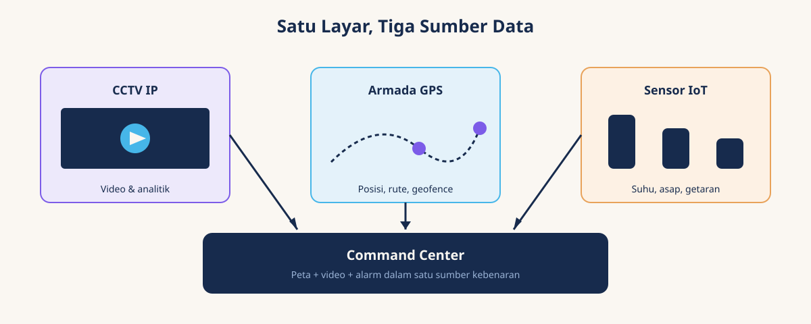
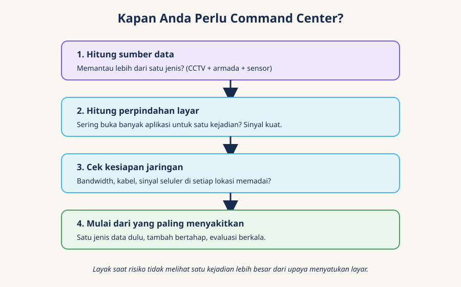
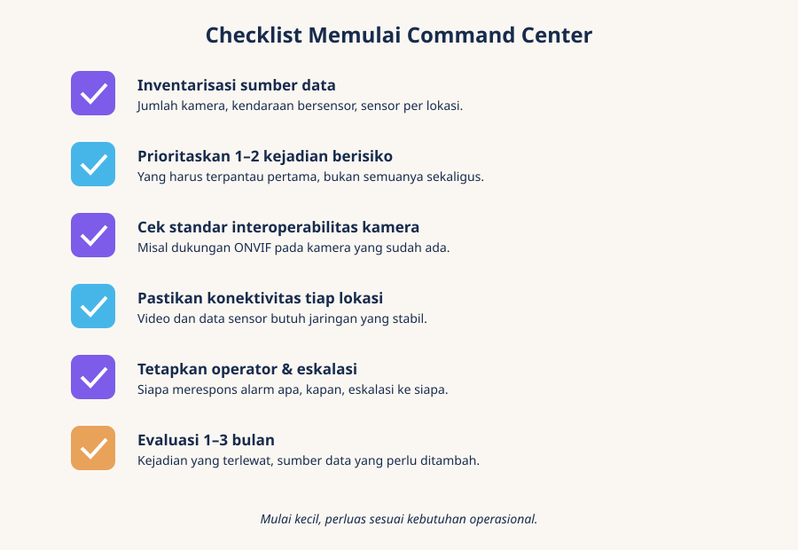

Jika Anda mengelola operasional dengan banyak aset bergerak dan banyak lokasi, Anda mungkin mengenal situasi ini: CCTV dipantau di satu aplikasi, posisi armada di aplikasi lain, alarm sensor di grup WhatsApp, dan absensi tim di spreadsheet. Semuanya "ada", tetapi tidak pernah bertemu di satu tempat. Ketika sesuatu terjadi — kendaraan berhenti di lokasi mencurigakan, suhu gudang naik, kamera di area penting mati — tim harus membuka tiga sampai empat layar hanya untuk memahami satu kejadian.

Command center adalah jawaban untuk masalah tersebut. Sederhananya, ini adalah satu layar (atau satu ruangan) tempat semua informasi operasional — video CCTV, posisi armada, data sensor, status perangkat — ditampilkan dan dikawal bersama. Untuk memantau server, website, dan proyek, Altora punya [Control Center](/aplikasi/control-center); untuk gabungan CCTV, armada, dan sensor di lokasi, kebutuhannya dirancang per proyek. Artikel ini menjelaskan apa yang dilakukan sebuah command center, teknologi yang membuatnya mungkin, kapan ia layak dibangun, dan kapan belum perlu.

## Apa yang sebenarnya dilakukan command center

Command center bukan sekadar "banyak CCTV di satu layar". Nilai utamanya adalah **konteks**: satu kejadian bisa dilihat dari beberapa sumber sekaligus.

Contoh sederhana: sensor di gudang mendeteksi suhu naik. Dalam command center yang terpadu, operator langsung melihat kamera area tersebut, posisi armada terdekat yang bisa dicek, dan riwayat alarm gudang itu — tanpa berpindah aplikasi. Keputusan yang tadinya membutuhkan beberapa menit lintas sistem dapat diambil lebih singkat.

Bentuknya bervariasi sesuai skala. Untuk usaha dengan satu-dua lokasi, command center bisa berupa satu dashboard di PC yang menampilkan peta, video, dan grafik sensor. Untuk perusahaan besar, ini bisa berupa ruangan khusus dengan dinding monitor dan operator bergantian 24 jam. Prinsipnya sama: **satu sumber kebenaran** untuk kondisi operasional.

## Tiga jenis data yang biasanya dipantau

### 1. Video CCTV (IP dan analitik)

Video adalah "mata" command center. Yang penting dipahami: kamera IP dari merek berbeda sering dapat bekerja bersama karena adanya standar interoperabilitas seperti ONVIF, yang mengatur antarmuka umum produk keamanan berbasis IP. Salah satu profilnya, Profile S, ditujukan untuk video berbasis IP: perangkat yang mendukungnya dapat mengirim video langsung ke perangkat lunak pemantau.

Artinya, Anda tidak selalu terikat satu merek kamera. Command center dapat menampilkan kamera lama dan baru dari merek berbeda di satu tata letak, selama kamera mendukung standar yang sama dan sudah diuji. Pilihan kamera tersedia di [pengadaan CCTV](/pengadaan#cctv). Ditambah analitik (misalnya deteksi objek atau APD), video berubah dari rekaman pasif menjadi sumber peringatan aktif.

### 2. Armada dan aset bergerak (GPS/telematika)

Untuk armada, data utamanya adalah posisi, rute, dan perilaku berkendara. GPS fleet tracking yang dipadukan telematika dapat membantu meninjau riwayat rute, perilaku pengemudi, waktu idle, kebutuhan perawatan, aktivitas bahan bakar, dan kejadian *geofence*, yaitu batas virtual di sekitar yard, lokasi kerja, depot, atau area terbatas. Pelajari lebih lanjut di [tracking armada dan aset](/services/tracking) dan [fleet management untuk logistik dan tambang](/blog/fleet-management-logistik-tambang).

Dalam command center, armada dan CCTV saling menguatkan: ketika kendaraan keluar geofence di luar jam kerja, operator bisa langsung memanggil kamera atau memeriksa konteksnya, bukan menebak dari laporan besok pagi.

### 3. Sensor IoT (lingkungan dan mesin)

Sensor suhu, kelembapan, asap, atau getaran adalah "saraf" yang terus membaca kondisi. Lewat [IoT custom](/services/iot-custom), data sensor dapat disatukan ke layar yang sama dengan video dan armada. Data masuk command center sebagai angka, grafik, dan alarm bertingkat. Bahasan lebih rinci ada di [monitoring suhu dan asap untuk ruang server dan gudang](/blog/monitoring-suhu-asap-iot).

## Keputusan: apakah Anda perlu command center

Gunakan alur berikut sebagai garis besar:

1. **Hitung sumber datanya.** Jika Anda memantau lebih dari satu jenis (misal CCTV *dan* armada), manfaat konsolidasi mulai terasa.
2. **Hitung perpindahan layar.** Berapa kali per minggu tim membuka lebih dari satu aplikasi untuk satu kejadian? Sering = sinyal kuat.
3. **Cek kesiapan jaringan.** Command center hidup dari konektivitas. Kamera dan sensor harus bisa mengirim data ke satu titik — periksa bandwidth, kabel, dan jaringan seluler di lokasi terpencil.
4. **Mulai dari yang paling menyakitkan.** Tidak perlu semuanya sekaligus. Pendekatan yang umum adalah mulai dari satu sumber data, misalnya armada, lalu menambah CCTV dan sensor.

> Prinsip praktis: command center layak dibangun ketika risiko *tidak melihat* satu kejadian penting lebih besar daripada upaya menyatukan layar.

## Batasan yang perlu Anda tahu sejak awal

- **Standar ≠ kompatibilitas total.** Kamera lama analog, atau kamera IP yang tidak mendukung profil standar mana pun, tidak bisa langsung ditampilkan. Kadang perlu encoder, kadang perlu penggantian.
- **Analitik bukan kebenaran mutlak.** Deteksi objek/APD mengurangi pekerjaan manual, tetapi masih butuh verifikasi manusia untuk keputusan penting. Command center adalah alat bantu operator, bukan penggantinya.
- **Jaringan adalah penentu utama.** Di lokasi dengan sinyal lemah, data armada bisa bolong dan video terputus. Rencanakan konektivitas sebelum perangkat lunak.
- **Proses manusia tetap perlu dirancang.** Layar besar tidak berguna jika tidak jelas siapa yang merespons alarm apa, kapan, dan eskalasinya ke siapa.

## Checklist memulai command center

- Daftar semua sumber data yang ada hari ini: jumlah kamera, kendaraan bersensor, dan sensor lingkungan per lokasi.
- Pilih 1–2 kejadian paling berisiko yang harus terpantau pertama.
- Periksa dukungan standar interoperabilitas (misal ONVIF) pada kamera yang ada.
- Pastikan konektivitas di setiap lokasi memadai untuk video dan data sensor.
- Tetapkan siapa operator, jam pantau, dan alur eskalasi alarm.
- Evaluasi setelah 1–3 bulan: kejadian apa yang terlewat, sumber data apa yang perlu ditambah.

## Penutup

Command center bukan tentang layar yang mengesankan, tetapi tentang mempercepat satu hal: dari *terjadi* ke *ditangani*. Ketika CCTV, armada, dan sensor berbicara dalam satu bahasa di satu layar, tim Anda menghabiskan waktu untuk bertindak, bukan mencari informasi.

Jika Anda ingin mendiskusikan bagaimana command center bisa disusun untuk operasional bisnis Anda — dari kombinasi kamera, armada, hingga sensor — [hubungi tim Altora](/contact) untuk konsultasi awal.
