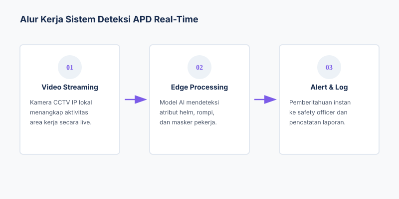
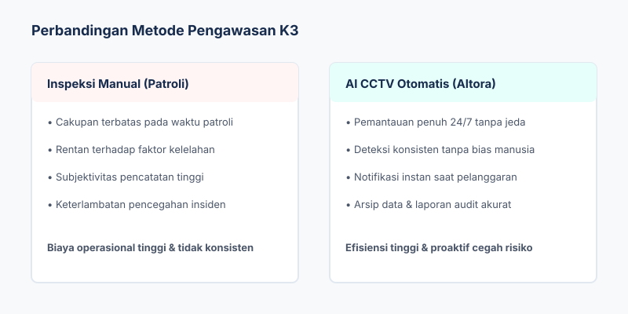

Keselamatan dan Kesehatan Kerja (K3) adalah prioritas utama di setiap proyek konstruksi maupun area industri. Namun, pengawasan kepatuhan penggunaan Alat Pelindung Diri (APD)—seperti helm pengaman, rompi reflektif, kacamata pelindung, hingga sepatu *safety*—sering kali menghadapi kendala di lapangan. Patroli manual oleh petugas K3 memiliki keterbatasan waktu, tenaga, dan jangkauan pandang, terutama pada area proyek yang luas atau kompleks.

Di sinilah **AI CCTV** dapat membantu. Dengan *computer vision*, sistem kamera tidak hanya merekam video, tetapi dapat menganalisis gambar secara langsung dan menandai pekerja yang tampak belum memakai perlengkapan keselamatan di zona yang mewajibkannya. Sistem ini membantu pengawas, bukan menggantikan mereka.

Artikel ini menjelaskan cara kerja deteksi APD berbasis AI CCTV, perbedaannya dengan pengawasan manual, serta batasan yang perlu dipahami pengelola proyek sebelum menerapkannya.

## Mengapa Pengawasan K3 Konvensional Sering Gagal?

Secara tradisional, pengawasan kepatuhan K3 mengandalkan inspeksi langsung oleh pengawas lapangan atau peninjauan rekaman CCTV secara manual setelah insiden terjadi. Pendekatan ini memiliki beberapa kelemahan mendasar yang sering dikeluhkan oleh manajemen proyek di lapangan:

1. **Keterbatasan Waktu dan Kelelahan Fisik:** Petugas pengawas memiliki keterbatasan daya tahan. Pengawasan intensif selama 24 jam penuh di seluruh zona kerja mustahil dilakukan secara konsisten oleh tenaga manusia tanpa jeda istirahat.
2. **Faktor Kelonggaran Sosial:** Terkadang pelanggaran kecil seperti melepas helm sejenak karena cuaca panas terabaikan atau dimaklumi jika tidak tertangkap basah oleh pengawas senior secara langsung.
3. **Sifatnya Reaktif, Bukan Preventif:** Rekaman CCTV konvensional umumnya baru dibuka setelah insiden atau kecelakaan terjadi, sehingga perusahaan kehilangan kesempatan emas untuk mencegah potensi bahaya sebelum insiden merugikan jatuh korban.

Karena itu, analitik kamera layak dipertimbangkan sebagai alat bantu tambahan agar pelanggaran lebih cepat terlihat, terutama di area yang luas.

## Bagaimana Sistem AI CCTV Mendeteksi APD Secara Otomatis

Sistem AI CCTV mengintegrasikan kamera pengawas beresolusi tinggi dengan modul pemrosesan (di perangkat lokal di lokasi proyek atau di server pusat) yang menjalankan model pengenalan objek untuk atribut keselamatan kerja. 

Proses deteksi dimulai saat kamera menangkap *feed* video aktivitas pekerja secara *live*. Model *deep learning* kemudian mencari objek yang relevan, seperti helm, rompi reflektif, dan perlengkapan lain sesuai konfigurasi. Jika sistem menilai seorang pekerja tidak mengenakan helm atau rompi di zona wajib APD, sistem dapat memicu peringatan atau mencatat kejadian itu ke *dashboard* pusat. Beberapa sistem dapat dikonfigurasi membedakan warna helm untuk peran tertentu, misalnya tamu atau pengawas, bila aturan di lokasi Anda memakai kode warna.

Dengan cara ini, kamera berubah dari alat investigasi setelah kejadian menjadi alat bantu yang mendukung tindakan pencegahan.

## Alur Kerja Sistem: Dari Tangkapan Kamera Hingga Peringatan

Implementasi sistem deteksi APD dirancang agar efisien dan langsung menghasilkan tindakan korektif di lapangan. Berikut adalah alur kerja standar dari sistem AI CCTV modern:

* **Video Streaming Live:** Kamera IP yang terpasang di titik strategis proyek mengirimkan aliran video secara terus-menerus ke unit pemrosesan komputer.
* **Analisis Algoritma AI:** Perangkat lunak mendeteksi keberadaan pekerja dan menilai perlengkapan keselamatan yang tampak pada gambar.
* **Peringatan (Alert):** Apabila ditemukan dugaan pelanggaran (misalnya pekerja tidak memakai helm), sistem dapat mengirimkan notifikasi berupa tangkapan layar (*snapshot*) ke perangkat pengawas atau membunyikan alarm lokal. Pengawas memverifikasi sebelum menegur.
* **Pencatatan Log & Laporan:** Seluruh data kejadian direkam dalam bentuk laporan harian atau mingguan untuk keperluan evaluasi manajemen K3 secara berkala.

Dengan alur tersebut, tindak lanjut dapat dilakukan lebih cepat daripada menunggu laporan akhir hari.

## Perbandingan Pengawasan K3: Manual vs AI CCTV

Untuk memberikan gambaran yang lebih objektif bagi pengambil keputusan di perusahaan konstruksi, berikut adalah perbandingan langsung antara metode pengawasan K3 konvensional dan otomatisasi AI CCTV:

* **Cakupan Waktu:** Inspeksi manual terbatas pada jam patroli tertentu, sedangkan AI CCTV dapat terus menganalisis selama kamera dan sistem aktif.
* **Konsistensi Penilaian:** Pengawasan manusia rentan terhadap kelelahan dan subjektivitas, sementara sistem menerapkan aturan yang sama pada setiap gambar, dengan kemungkinan salah deteksi yang tetap perlu diverifikasi.
* **Kecepatan Tindakan:** Manual bergantung pada laporan lisan; sistem dapat mengirim notifikasi segera setelah dugaan pelanggaran terdeteksi.
* **Arsip dan Audit:** Laporan manual sering kali tidak lengkap atau hilang, sedangkan sistem digital menyimpan riwayat kejadian yang dapat dipakai sebagai bahan evaluasi keselamatan.

Meski membantu dari sisi kecepatan dan konsistensi, pengelola proyek tetap perlu memperhatikan beberapa batasan agar sistem berjalan baik.

## Batasan Teknis dan Hal yang Perlu Diperhatikan

Teknologi ini membantu pengawasan, tetapi tidak menjamin tidak ada pelanggaran yang terlewat. Pahami batasan berikut sebelum instalasi:

* **Kondisi Pencahayaan Ekstrem:** Area kerja yang terlalu gelap gulita atau silau akibat pantulan matahari langsung dapat menurunkan akurasi deteksi model *computer vision*. Kamera dengan *infrared* atau penambahan lampu dapat membantu, dan hasilnya perlu diuji di lokasi.
* **Halangan Fisik (Oklusi):** Jika pekerja tertutup oleh alat berat, material bangunan, atau pilar secara penuh dari sudut pandang kamera, sistem tidak dapat mendeteksi atribut mereka secara akurat. Penempatan beberapa sudut kamera (*multi-angle*) dapat mengurangi masalah ini.
* **Cuaca, debu, dan kebersihan lensa:** Hujan lebat, kabut debu, atau lensa kotor dapat menurunkan hasil pembacaan, sehingga lensa perlu dibersihkan berkala.
* **Kapasitas pemrosesan dan jaringan:** Pemrosesan video membutuhkan perangkat komputasi di lokasi (*edge*) atau *bandwidth* yang stabil bila memakai *cloud*; makin banyak kamera, makin besar kebutuhannya.
* **Privasi dan kebijakan:** Beritahukan kepada pekerja bahwa area diawasi kamera, tetapkan siapa yang boleh melihat rekaman, dan jadikan hasil deteksi sebagai bahan pembinaan, bukan satu-satunya dasar sanksi.

Memahami batasan ini membantu merancang tata letak kamera yang realistis sesuai kondisi lapangan.

## Kesimpulan

Deteksi APD dengan AI CCTV dapat membantu pengawas K3 melihat dugaan pelanggaran lebih cepat dan menyimpan catatannya, terutama di area luas. Ia tetap alat bantu: kepatuhan keselamatan bergantung pada SOP, pelatihan, dan pengawas di lapangan.

Untuk gambaran pekerjaan serupa, lihat [deteksi APD berbasis AI](/portofolio/deteksi-apd-ai) di portofolio kami. Analitik seperti ini dikerjakan sebagai proyek lewat [AI custom](/services/ai-custom), sedangkan kamera dan perangkat pendukungnya dapat dilihat di [pengadaan CCTV](/pengadaan#cctv). Bila Anda ingin mendiskusikan kondisi lokasi proyek, [hubungi tim Altora](/contact).
