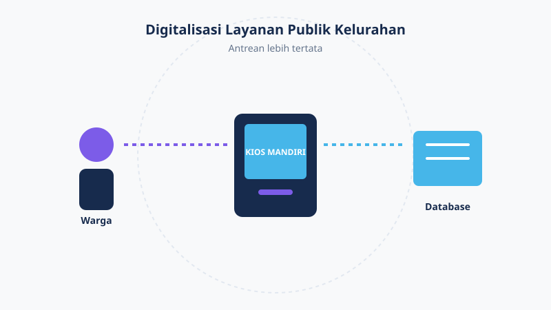
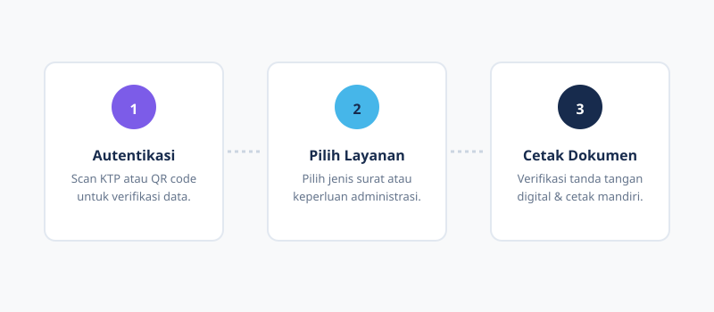
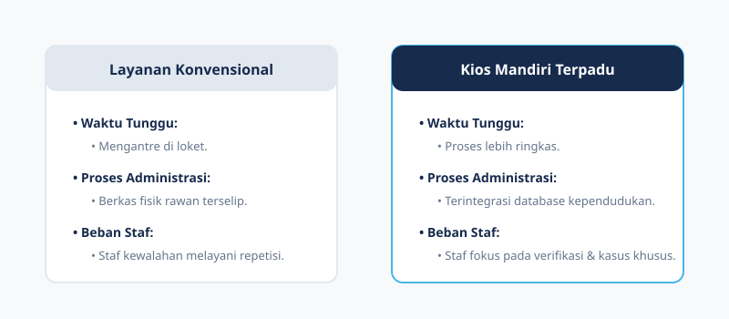

Pelayanan publik di tingkat kelurahan dan instansi pemerintahan sering menghadapi tantangan klasik: antrean warga, jam loket yang terbatas, dan berkas fisik yang menumpuk. Seiring meningkatnya harapan masyarakat terhadap layanan yang cepat dan jelas, anjungan layanan mandiri atau kios digital dapat menjadi salah satu cara untuk meringankan pekerjaan loket.

Tujuannya bukan menggantikan petugas. Kios mengambil alih tugas yang berulang, seperti permohonan surat tertentu atau pencetakan berkas yang sudah disetujui, sehingga petugas punya lebih banyak waktu untuk verifikasi, konsultasi, dan kasus yang memerlukan penanganan langsung. Artikel ini membahas alur penggunaan, batasan, keamanan data, dan perawatan perangkat yang perlu disiapkan sejak awal.

## Transformasi Pelayanan Publik Kelurahan Melalui Kios Mandiri

Kios layanan mandiri biasanya berupa perangkat layar sentuh dengan printer dan casing yang dirancang untuk area publik. Warga memilih layanan, mengisi data singkat bila diperlukan, lalu mencetak berkas sendiri. Perangkat yang kuat dan antarmuka yang mudah dipahami membantu warga dari berbagai usia menggunakannya tanpa pendampingan panjang.

Ketika kios dipakai, alur kerja kantor ikut bergeser. Petugas yang sebelumnya banyak melayani pencetakan dokumen dasar dapat dialihkan untuk memeriksa data yang lebih kompleks dan membantu warga yang membutuhkan. Dampaknya perlu dipantau setelah kios berjalan; jangan mengandalkan perkiraan semata.

## Alur Penggunaan Anjungan Layanan Mandiri untuk Warga

Kemudahan penggunaan menentukan apakah kios dipakai atau dibiarkan. Alur yang dirancang bersama instansi umumnya dimulai dari identifikasi warga, misalnya dengan memasukkan data atau memindai kode sesuai prosedur dan izin akses data yang berlaku di instansi tersebut. Setelah itu warga memilih jenis layanan, melengkapi kolom isian singkat, memeriksa ringkasan permohonan, lalu mencetak atau menerima bukti pengambilan.

Cara identifikasi, jenis dokumen yang boleh dicetak mandiri, dan bentuk pengesahan dokumen ditentukan oleh kebijakan instansi, bukan oleh perangkat. Karena itu, petakan dahulu layanan mana yang paling sering diminta dan aman untuk dijalankan mandiri.

## Perbandingan Layanan Manual dan Kios Mandiri

Pada layanan manual, warga datang pada jam kerja, mengambil nomor antrean, dan menunggu giliran untuk menyerahkan berkas. Berkas dapat terselip dan pencatatan oleh petugas bisa berbeda-beda. Pada layanan dengan kios, alur permohonan lebih seragam, warga memperoleh kepastian langkah, dan pimpinan dapat melihat ringkasan volume layanan jika sistem mencatatnya.

Perbedaan ini baru terasa bila kios ditempatkan pada layanan yang tepat dan didukung prosedur yang jelas. Sebagai contoh pekerjaan kami, lihat [anjungan layanan mandiri kelurahan](/portofolio/kios-mandiri-kelurahan) di portofolio, serta perangkat kios dan display di [halaman pengadaan](/pengadaan#display).

## Tantangan dan Batasan Implementasi di Lapangan

Pertama, jaringan internet dan pasokan listrik di lokasi harus stabil agar kios tidak sering berhenti. Siapkan juga prosedur ketika kios rusak, kertas printer habis, atau koneksi terputus, supaya warga tetap dapat dilayani di loket.

Kedua, literasi digital warga tetap perlu diperhatikan. Sediakan petunjuk visual yang jelas dan pendampingan di awal bagi warga lanjut usia atau yang belum terbiasa dengan layar sentuh. Kios sebaiknya melengkapi loket, bukan menjadi satu-satunya jalur.

## Integrasi Data dan Keamanan Informasi Kependudukan

Data kependudukan bersifat sensitif. Pastikan komunikasi antara kios dan server dienkripsi, data pribadi tidak disimpan lebih lama dari yang diperlukan, dan layar kios tidak menampilkan data warga setelah transaksi selesai. Hak akses administrator dan operator diatur berdasarkan peran: hanya petugas berwenang yang boleh memverifikasi laporan atau mengubah templat surat. Kerangka kebijakan dan kewenangan pengelolaan data tetap berada pada instansi; vendor menyesuaikan sistem dengan ketentuan tersebut.

Untuk daftar periksa keamanan aplikasi yang lebih rinci, baca [checklist keamanan aplikasi bisnis sebelum go-live](/blog/checklist-keamanan-aplikasi-bisnis).

## Pemeliharaan Perangkat Keras dan Keandalan Sistem

Perangkat di ruang publik menghadapi debu, kelembapan, dan sentuhan layar yang intens. Pilih komponen yang dirancang untuk pemakaian intensif dan tentukan siapa yang merawat perangkat. Pemantauan jarak jauh membantu teknisi mengetahui masalah seperti printer kehabisan kertas atau jaringan terputus sebelum warga mengeluh, dengan catatan notifikasinya diterima oleh orang yang jelas.

## Langkah Strategis Memulai Digitalisasi Instansi

Mulailah dari pemetaan alur administrasi yang paling sering diakses warga, lalu pilih satu atau dua layanan untuk uji coba di satu lokasi. Evaluasi hambatan warga dan petugas, perbaiki alurnya, baru perluas ke layanan atau lokasi lain.

Bila instansi Anda membutuhkan sistem layanan yang disesuaikan dengan birokrasi lokal, pelajari [layanan software custom](/services/software-custom). Untuk pengadaan perangkat anjungan, lihat [kios dan display di halaman pengadaan](/pengadaan#display). Jika ingin berdiskusi tentang rancangan layanan publik digital, [hubungi tim Altora](/contact).
