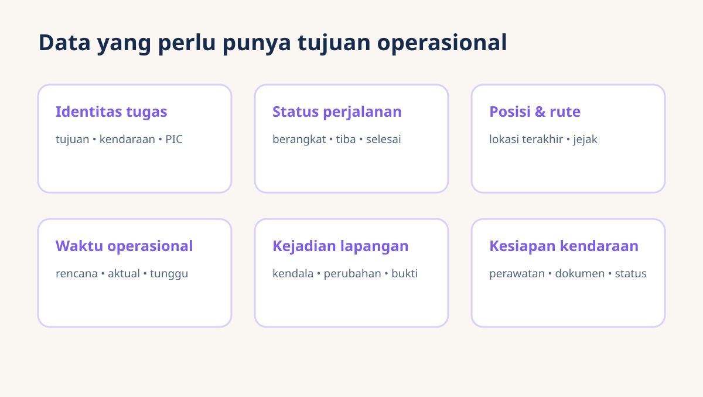
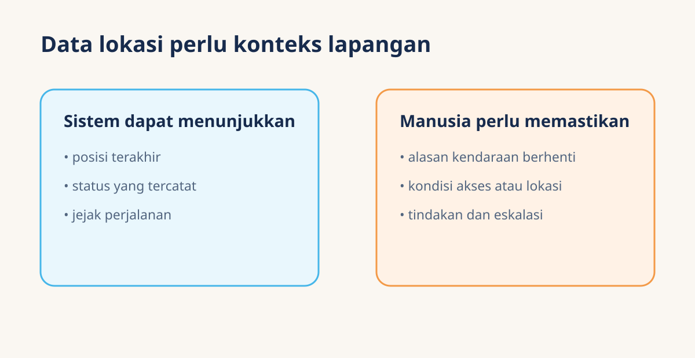
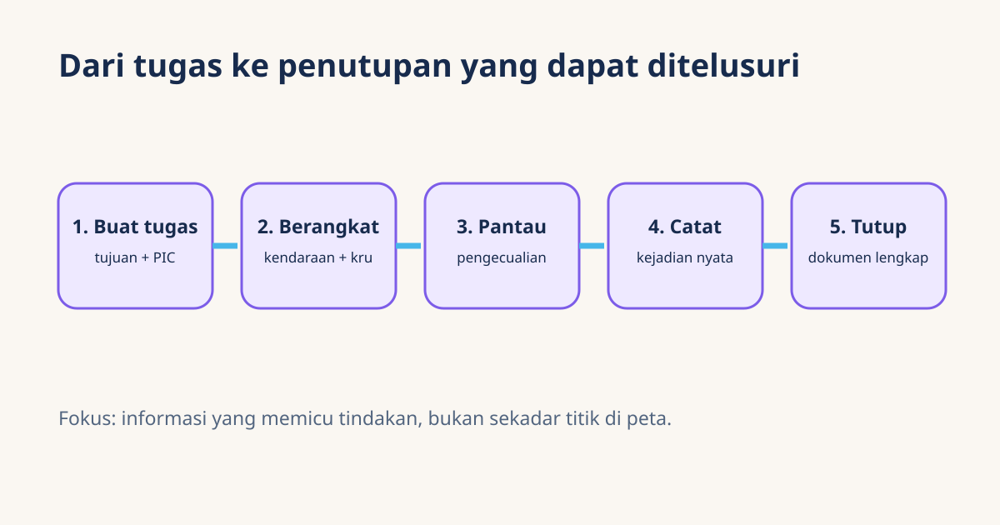
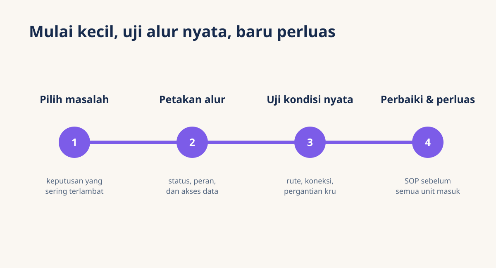

Armada logistik dan kendaraan operasional tambang bekerja jauh dari meja administrasi. Ketika informasi perjalanan hanya tiba lewat telepon, grup chat, atau kertas setelah kendaraan kembali, pengawas harus menyusun ulang cerita: kendaraan berada di mana, sedang menjalankan tugas apa, dan adakah kondisi yang perlu ditindaklanjuti. Waktu habis bukan hanya untuk mencari data, tetapi juga untuk menyamakan versi informasi.

*Fleet management* adalah cara mengelola kendaraan, pengemudi, dan tugas lapangan dengan catatan yang lebih terhubung. Sistemnya dapat mengumpulkan posisi dari perangkat di kendaraan, status perjalanan dari operator, serta catatan kejadian yang relevan bagi operasi. Bukan berarti semua kendaraan harus langsung dipantau dengan layar penuh indikator. Titik awal yang baik adalah memilih informasi yang benar-benar mengubah tindakan harian.

Untuk perusahaan di Kalimantan Timur, kebutuhan itu dapat berbeda antara distribusi, kontraktor proyek, dan operasi tambang. Jalur hauling yang panjang, jarak antarsite, dan area tanpa sinyal membuat informasi lapangan lebih sulit sampai tepat waktu. Artikel ini membantu Anda menentukan apa yang layak dipantau, menata prosesnya, dan mengenali batasannya sebelum sistem dipilih.

## Mulai dari keputusan yang sering terlambat

Jangan memulai dengan pertanyaan, “fitur apa yang tersedia?” Mulailah dari keputusan yang kini sulit dibuat tepat waktu. Misalnya, dispatcher perlu mengetahui kendaraan mana yang masih dapat menerima tugas. Pengawas ingin melihat apakah rute dan waktu perjalanan sesuai rencana. Tim administrasi perlu mencocokkan perjalanan dengan dokumen kerja tanpa menelusuri chat satu per satu.

Tuliskan satu alur nyata dari awal sampai selesai: tugas dibuat, kendaraan ditetapkan, pengemudi berangkat, perjalanan dipantau, kejadian dicatat, lalu tugas ditutup. Pada setiap tahap, tandai siapa yang memasukkan data dan siapa yang mengambil keputusan. Jika suatu informasi tidak memiliki pemilik atau tindak lanjut, jangan jadikan ia indikator utama hanya karena bisa dikumpulkan.

> Sistem yang berguna tidak hanya menunjukkan lokasi. Sistem harus membantu orang yang tepat mengambil tindakan sebelum keterlambatan menjadi laporan akhir hari.

## Data armada yang umumnya perlu dipantau

Kebutuhan setiap operasi berbeda, tetapi daftar berikut dapat menjadi titik diskusi awal dengan tim lapangan dan manajemen.

- **Identitas tugas:** nomor tugas, pelanggan atau lokasi kerja, kendaraan, pengemudi, dan penanggung jawab.
- **Status perjalanan:** belum berangkat, dalam perjalanan, tiba, menunggu, selesai, atau perlu perhatian. Gunakan istilah yang dipahami kru Anda.
- **Posisi dan jejak rute:** lokasi terakhir serta riwayat perjalanan untuk meninjau pelaksanaan tugas, bukan untuk menggantikan komunikasi saat situasi darurat.
- **Waktu operasional:** waktu penugasan, keberangkatan, tiba, selesai, dan waktu tunggu bila definisinya sudah disepakati.
- **Kejadian lapangan:** perubahan tujuan, kendala akses, kerusakan, atau insiden yang memerlukan bukti dan eskalasi.
- **Kondisi kendaraan:** jadwal perawatan, dokumen penting, dan status kesiapan bila data tersebut memang dikelola oleh tim Anda.

Data mentah tanpa definisi akan menambah perdebatan. Sepakati arti “tiba”, kapan perjalanan dianggap selesai, dan siapa yang berhak mengubah status. Untuk operasi besar, aturan ini sama pentingnya dengan peta di layar. Sistem [fleet management](/services/tracking) perlu mengikuti prosedur kerja yang jelas, bukan memaksa kru menebak-nebak istilah baru.

## Bedakan pemantauan operasi dan pengawasan berlebihan

Lokasi kendaraan dapat membantu koordinasi, tetapi bukan jawaban untuk semua masalah. Sinyal perangkat dapat terlambat atau hilang di area tertentu. Peta juga tidak selalu menerangkan alasan kendaraan berhenti: bisa karena antrean, pemeriksaan, kondisi jalan, instruksi lokasi, atau gangguan teknis. Karena itu, status dari operator dan catatan kejadian tetap penting.

Tetapkan akses berdasarkan peran. Dispatcher mungkin memerlukan kendaraan aktif hari ini, sedangkan manajemen melihat ringkasan operasi. Data historis, identitas pengemudi, dan ekspor laporan sebaiknya tidak terbuka untuk semua orang. Jelaskan kepada pengemudi data apa yang dicatat, untuk tujuan operasional apa, siapa yang dapat melihatnya, dan bagaimana koreksi dilakukan bila ada kesalahan.

Fleet management juga bukan pengganti inspeksi kendaraan, pelatihan keselamatan, atau keputusan pengawas di lapangan. Bila masalah utamanya adalah SOP tidak ada, jadwal tidak pernah dibuat, atau tanggung jawab tidak jelas, memasang perangkat saja hanya menghasilkan data baru tanpa perbaikan alur.

## Rancang alur dari tugas sampai penutupan

Sebelum menghubungkan banyak kendaraan, uji proses pada satu jenis perjalanan yang paling sering terjadi. Gunakan alur sederhana berikut.

1. Buat tugas dengan tujuan, waktu rencana, kendaraan, pengemudi, dan PIC.
2. Pastikan perangkat, akun pengguna, serta aturan status sudah diuji sebelum keberangkatan.
3. Pantau hanya pengecualian yang membutuhkan tindakan, seperti perubahan status, keterlambatan yang sudah memiliki definisi, atau kendala yang dilaporkan.
4. Catat alasan perubahan dari sumber yang dapat dipertanggungjawabkan, bukan asumsi dari titik peta.
5. Tutup tugas setelah dokumen dan status lapangan lengkap, lalu tinjau pola masalah untuk perbaikan berikutnya.

Alur ini membantu membedakan data langsung dengan data yang perlu dikonfirmasi manusia. Saat kebutuhan berkembang, [layanan tracking dan fleet management](/services/tracking) dapat dirancang agar peran kantor, koordinator, dan lapangan melihat informasi yang sesuai tanpa mencampur semua pekerjaan dalam satu layar.

## Perangkat, koneksi, dan integrasi perlu diuji di kondisi nyata

Pemilihan perangkat tidak boleh hanya didasarkan pada demonstrasi. Periksa cara pemasangan, sumber daya, perlindungan fisik, pencatatan saat koneksi putus, serta prosedur pemeriksaan bila perangkat tidak mengirim data. Tentukan juga siapa yang merawat perangkat dan bagaimana unit pengganti dicatat. Kegagalan kecil yang tidak memiliki pemilik cepat berubah menjadi titik buta operasional.

Jika Anda ingin menghubungkan data armada ke sistem lain, prioritaskan integrasi yang mengurangi input ulang. Contohnya, tugas dari sistem operasional dapat menjadi rujukan perjalanan, atau hasil perjalanan dapat menjadi bahan verifikasi administrasi. Jangan memaksa semua data lama masuk pada hari pertama. Mulai dari field yang dipakai untuk keputusan dan audit internal. Untuk perangkat GPS dan sensor pendukung, lihat juga [pengadaan GPS dan telematika](/pengadaan#gps).

Sebelum peluncuran lebih luas, lakukan uji rute, uji pergantian pengemudi, uji kendaraan berhenti, uji koneksi yang terputus, dan uji hak akses tiap peran. Catat hasilnya sebagai bahan memperbaiki SOP dan konfigurasi, bukan sebagai alasan menyalahkan pengguna.

## Jalur tanpa sinyal dan perawatan berkala

Di area pedalaman, koneksi seluler dapat hilang di sebagian rute. Tanyakan kepada penyedia perangkat apakah unit menyimpan data di memori internal saat koneksi putus lalu mengirimkannya setelah kendaraan kembali terjangkau jaringan (*store-and-forward*), dan sampai berapa lama data dapat disimpan. Kemampuan ini mengurangi lubang pada riwayat perjalanan, tetapi tidak membuat posisi terbaru tetap terlihat selama kendaraan berada di luar jangkauan.

Data kendaraan juga dapat dikaitkan dengan jadwal perawatan berbasis kilometer atau jam kerja mesin. Pengingat servis membantu bengkel menyiapkan unit sebelum jadwalnya terlewat; manfaatnya bergantung pada kebiasaan mencatat hasil perawatan, bukan pada perangkat saja. Bila bahan bakar ikut dipantau, sepakati cara membaca data tangki, waktu mesin menyala tanpa bergerak, dan kalibrasi sensor agar temuan dapat dipertanggungjawabkan.

Contoh implementasi di lapangan dapat dilihat pada [fleet management armada hauling](/portofolio/fleet-management-tambang) dan [GPS armada serta radio marine VHF](/portofolio/fleet-radio-kapal).

## Checklist awal untuk pemilik operasi

- Pilih satu masalah keputusan yang ingin dipercepat.
- Petakan alur tugas saat ini, termasuk pihak yang memberi dan menerima informasi.
- Tetapkan definisi status serta pihak yang boleh mengubahnya.
- Kelompokkan akses data berdasarkan kebutuhan kerja.
- Uji perangkat dan koneksi pada rute operasional nyata.
- Jalankan pilot terbatas, kumpulkan hambatan, lalu perbaiki proses sebelum diperluas.

Fleet management layak dipertimbangkan ketika koordinasi armada sudah bergantung pada informasi yang cepat, dapat ditelusuri, dan dipahami bersama. Ukur keberhasilannya dari berkurangnya pekerjaan ulang dan lebih cepatnya tindak lanjut, bukan dari banyaknya indikator di layar. Bila Anda ingin memetakan kebutuhan armada dan alur lapangan sebelum memilih pendekatan, [hubungi tim Altora](/contact).
