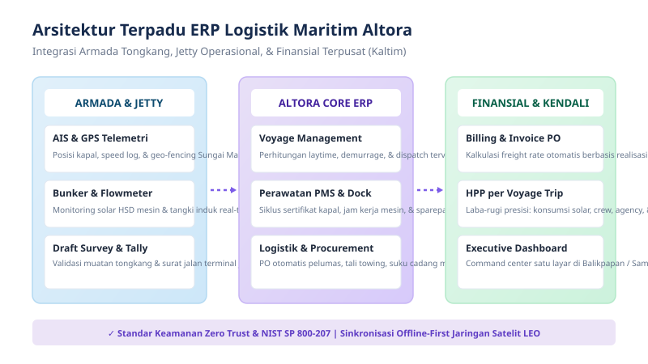
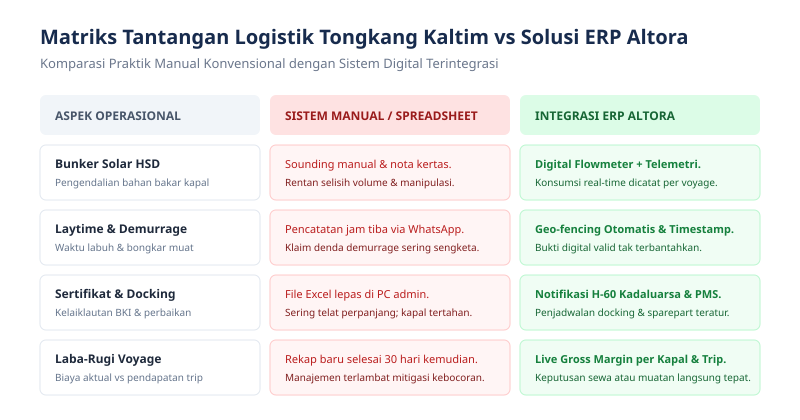
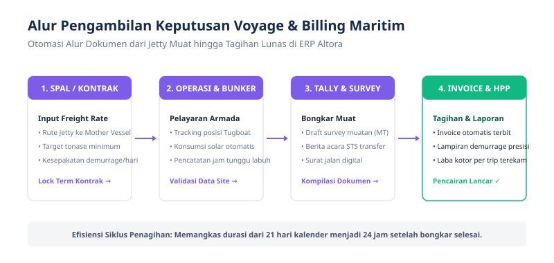
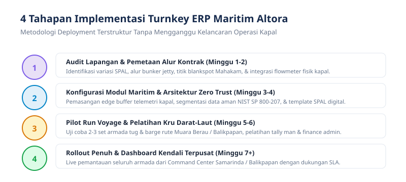

Kalimantan Timur merupakan urat nadi logistik komoditas nasional, di mana jutaan metrik ton batubara, minyak kelapa sawit mentah (*crude palm oil* / CPO), dan material konstruksi dipindahkan setiap harinya menyusuri Sungai Mahakam menuju pelabuhan muat dan kapal induk (*mother vessel*) di Muara Berau maupun Teluk Balikpapan. Di balik skala perputaran kargo yang luar biasa ini, perusahaan pelayaran, pemilik kapal tunda (*tugboat*), dan armada tongkang (*barge*) berhadapan dengan kompleksitas operasional maritim yang unik dan dinamis.

Banyak pengelola logistik laut masih mengandalkan kombinasi pesan singkat WhatsApp lapangan, spreadsheet Excel yang terfragmentasi, dan tumpukan berkas berita acara fisik untuk mengontrol pergerakan aset. Pola kerja manual ini kerap memicu kebocoran finansial yang signifikan: ketidaksesuaian laporan volume solar bunker, perselisihan denda keterlambatan bongkar muat (*demurrage*), hingga siklus penagihan faktur (*invoicing*) yang tertahan berminggu-minggu karena lambatnya verifikasi dokumen *draft survey* dan surat jalan terminal *jetty*.

Penerapan sistem *Enterprise Resource Planning* (ERP) maritim yang terintegrasi secara spesifik menjadi pilar vital untuk mempertahankan profitabilitas di tengah fluktuasi tarif kargo (*freight rate*). Melalui pendekatan *custom software* yang dikembangkan oleh [Altora Indonesia](https://altora.id/), seluruh variabel operasi—mulai dari posisi armada sungai, konsumsi bahan bakar, sertifikasi kelaiklautan kapal, hingga laba-rugi per pelayaran (*voyage*)—dapat dipantau secara langsung dalam satu dasbor terpadu.

## Mengapa ERP generalis sering gagal di operasional maritim Kaltim?

Sebagian besar perangkat lunak akuntansi dan ERP generalis di pasaran dirancang untuk entitas manufaktur pabrik atau toko retail berbasis gudang statis. Ketika dipaksakan ke industri perkapalan sungai dan laut di pedalaman Kalimantan Timur, sistem tersebut segera menemui jalan buntu karena tidak memiliki struktur data untuk menangani variabel operasi kelautan.

Operasional logistik maritim memiliki dinamika khas yang membutuhkan kapabilitas software khusus:

1. **Struktur Biaya Berbasis Voyage (Per Pelayaran):** Pendapatan dan beban operasional tidak semata-mata dihitung per bulan kalender, melainkan per nomor trip atau kontrak pelayaran (*Surat Perjanjian Angkutan Laut* / SPAL). Sistem harus mampu mengisolasi seluruh pengeluaran langsung satu trip—mulai dari ribuan liter solar HSD, biaya tambat labuh, jasa pandu kolam pelabuhan, hingga premi kru kapal—untuk menghitung harga pokok penjualan (HPP) secara presisi.
2. **Kalkulasi Laytime dan Demurrage yang Kompleks:** Waktu tunggu muat di *jetty* atau *transshipment* di laut lepas sering kali molor akibat pasang surut air Sungai Mahakam, cuaca buruk, maupun antrean *loading* di *conveyor belt*. Sengketa denda *demurrage* bernilai besar kerap terjadi hanya karena waktu tiba (*Notice of Readiness* / NOR) dicatat secara subjektif di catatan kertas.
3. **Kondisi Komunikasi Blankspot Sungai:** Kapal yang berlayar ke hulu Sungai Mahakam menuju Kutai Barat atau Mahakam Ulu kerap kehilangan sinyal seluler selama berhari-hari. Software operasional kapal wajib memiliki kapabilitas *offline-first sync* yang andal, menyimpan data laporan harian mesin (*engine log*) secara lokal dan langsung menyinkronkannya saat kembali terhubung ke jaringan internet satelit atau menara BTS terdekat.

## 4 Modul kunci sistem ERP maritim terpadu

Sistem ERP logistik maritim yang efektif mengintegrasikan setiap divisi kantor pusat di Balikpapan atau Samarinda dengan operasional armada di perairan. Empat modul inti berikut membentuk arsitektur digital menyeluruh:

### 1. Manajemen Voyage dan Kontrak SPAL Terpusat
Setiap order pelayaran bermula dari penerbitan SPAL atau kontrak sewa waktu (*time charter*). Sistem mencatat kesepakatan tarif dasar per metrik ton, kuota jam labuh (*laytime allowance*), serta denda keterlambatan per hari. Saat armada tugboat dan tongkang ditugaskan, sistem mengunci identitas kapal (*barge assignment*), kuota bahan bakar yang diizinkan untuk rute tersebut, dan target jadwal tiba.

### 2. Telemetri Real-Time & Pengawasan Bunker Solar
Bahan bakar minyak (BBM) adalah salah satu komponen biaya terbesar dalam operasional kapal. Integrasi modul ERP Altora dengan instrumen *digital flowmeter* dan telemetri GPS memungkinkan pemantauan konsumsi liter per jam secara terus-menerus. Jika terjadi lonjakan konsumsi yang tidak wajar di luar profil kecepatan jelajah kapal, atau jika sensor ketinggian tangki mencatat penurunan mendadak saat kapal bersandar di malam hari, sistem otomatis memicu peringatan darurat ke manajer operasi.

### 3. Perawatan Terencana (PMS) dan Siklus Dok Kapal
Kapal yang berhenti beroperasi karena kerusakan mendadak (*breakdown*) menimbulkan kerugian sewa yang sangat tinggi. Modul *Planned Maintenance System* (PMS) melacak jam kerja (*running hours*) mesin induk, generator genset, dan pompa hidrolik tongkang. Sistem juga memantau tanggal masa berlaku puluhan sertifikat kelaiklautan dari Biro Klasifikasi Indonesia (BKI) maupun Syahbandar, mengirimkan peringatan otomatis 60 hari sebelum jadwal survei tahunan atau *docking* tiba.

### 4. Billing Otomatis dan Otomasi Surat Jalan Terminal
Setelah proses bongkar kargo selesai dan *draft survey report* ditandatangani oleh surveyor independen, data tonase aktual langsung dimasukkan ke dalam modul penagihan. Sistem otomatis menghitung total nilai *freight*, menambahkan kompensasi *demurrage* yang telah divalidasi oleh riwayat geo-fencing GPS, dan menerbitkan faktur tagihan resmi lengkap dengan lampiran berita acara digital. Karena data tonase, demurrage, dan berita acara sudah tersusun saat bongkar selesai, siklus penagihan bisa dipersingkat.

## Standar keamanan data & arsitektur Zero Trust

Di lingkungan industri strategis, sistem ERP perusahaan menyimpan data kontrak sensitif, tarif rahasia, serta lokasi aset logistik nasional. Altora merancang sistem dengan prinsip arsitektur keamanan *Zero Trust* yang mengacu pada pedoman [NIST SP 800-207](https://csrc.nist.gov/pubs/sp/800/207/final). Setiap permintaan akses ke server ERP—baik dari kantor cabang di Samarinda, petugas operasional di dermaga Muara Jawa, maupun kapten kapal di atas tugboat—wajib melalui otentikasi identitas multi-faktor dan validasi hak akses berbasis peran (*Role-Based Access Control* / RBAC).

Komunikasi data antara perangkat telemetri lapangan dan server basis data dienkripsi, dengan kerangka kontrol sistem informasi yang mengacu pada [NIST SP 800-53 Rev. 5](https://csrc.nist.gov/pubs/sp/800/53/r5/upd1/final). Melalui segmentasi jaringan yang ketat, risiko intersepsi data muatan komoditas maupun serangan siber ke sistem logistik dapat dimitigasi secara komprehensif.

## 4 Tahapan implementasi sistem turnkey bersama Altora

Penerapan sistem ERP pada armada maritim yang sedang aktif berlayar membutuhkan kehati-hatian agar tidak mengganggu operasional harian. Altora mengadopsi metodologi peluncuran bertahap (*turnkey phased implementation*):

1. **Survei Lapangan & Audit Variasi SPAL (Minggu 1–2):** Tim teknis kami mempelajari alur penerbitan SPAL yang berjalan, skema perhitungan bahan bakar per jenis rute (sungai vs laut terbuka), serta kesiapan sensor telemetri pada armada kapal Anda.
2. **Kustomisasi Modul & Pengaturan Arsitektur (Minggu 3–4):** Mengonfigurasi parameter sistem, merancang template laporan komparasi voyage, dan menyiapkan mekanisme penyimpanan sementara (*local buffer storage*) untuk mengantisipasi putusnya koneksi di hulu sungai.
3. **Uji Coba Pilot Armada Terpilih (Minggu 5–6):** Menerapkan sistem pada 2 hingga 3 set armada *tug & barge* aktif. Tim darat dan staf administrasi mulai menjalankan pencatatan digital harian secara paralel dengan pendampingan langsung.
4. **Peluncuran Penuh & Dashboard Kendali Pusat (Minggu 7+):** Menghubungkan seluruh armada ke dalam *command center dashboard* di kantor manajemen Samarinda atau Balikpapan, dilengkapi dukungan teknis lokal dengan kesepakatan tingkat layanan (*SLA*).

Digitalisasi operasional maritim bukan lagi beban biaya administratif, melainkan upaya untuk melindungi margin perusahaan dari inefisiensi solar dan keterlambatan penagihan. Dengan landasan perangkat lunak yang dirancang khusus memahami kondisi lapangan perairan Kalimantan Timur, perusahaan logistik maritim Anda siap melaju lebih lincah dan berdaya saing tinggi.

Apakah perusahaan pelayaran dan armada tongkang Anda ingin mengoptimalkan transparansi voyage, menghentikan kebocoran BBM, dan mempercepat arus kas penagihan? Diskusikan kebutuhan Anda dengan tim kami lewat [halaman kontak Altora](https://altora.id/contact). Contoh pekerjaan kami di sektor ini ada di [portofolio](/portofolio).
