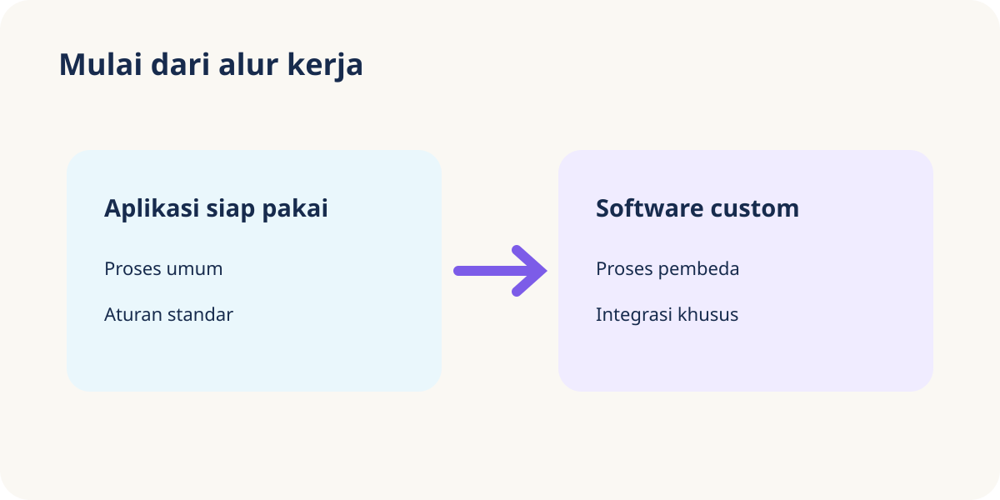
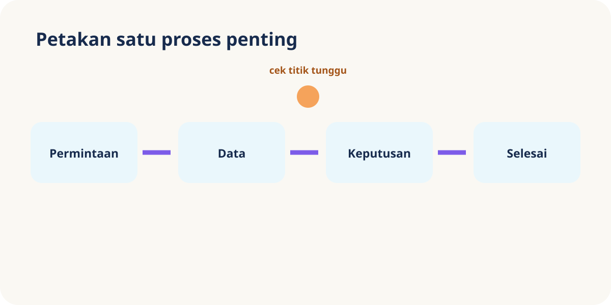
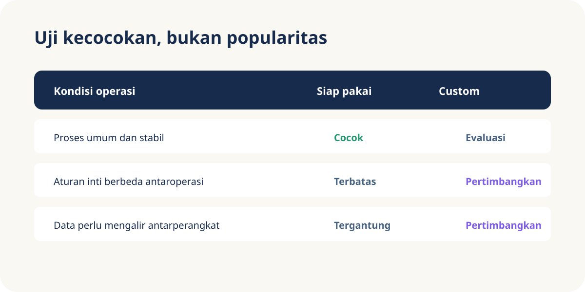
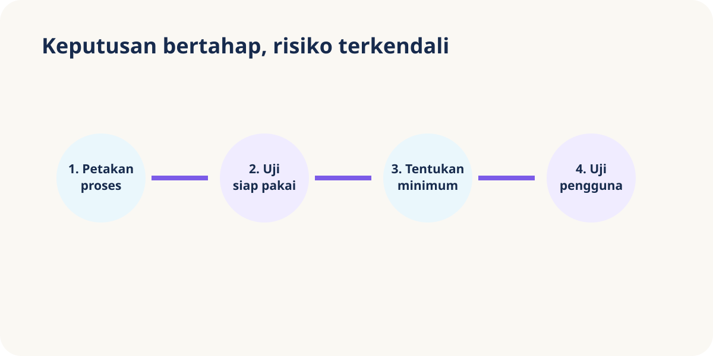

Saat pekerjaan operasional mulai terasa lambat, banyak bisnis langsung bertanya: apakah harus membuat aplikasi sendiri? Jawabannya tidak selalu. Aplikasi siap pakai dapat menjadi pilihan tepat bila alur kerja Anda umum, dapat mengikuti cara kerja produk tersebut, dan kebutuhan utama bisa dipenuhi tanpa banyak penyesuaian.

Namun, ada kondisi ketika tim terus membuat jalan pintas di luar sistem: data dipindah berulang antarfile, persetujuan berjalan di chat, laporan perlu dirapikan manual, atau satu proses penting tidak cocok dengan cara kerja aplikasi yang dipakai. Di titik itu, software custom layak dipertimbangkan—bukan karena membuat aplikasi sendiri terdengar lebih canggih, melainkan karena operasi membutuhkan alur yang benar-benar pas.

## Mulai dari proses kerja, bukan daftar fitur

Sebelum membandingkan produk, petakan satu alur kerja yang paling sering menghambat tim. Misalnya proses dari permintaan pelanggan sampai pekerjaan selesai, dari barang masuk sampai stok terbarui, atau dari laporan lapangan sampai persetujuan manajer. Catat siapa yang memulai, informasi apa yang dibutuhkan, keputusan apa yang dibuat, dan di mana pekerjaan berhenti.

Pemetaan ini membedakan masalah proses dari masalah alat. Kadang hambatan muncul karena aturan kerja belum jelas, data master tidak rapi, atau tanggung jawab antarperan tumpang tindih. Membuat software baru tidak otomatis memperbaiki masalah tersebut. Sebaliknya, bila alur sudah jelas tetapi selalu dipaksa mengikuti batas aplikasi, kebutuhan kustom menjadi lebih nyata.

Tanyakan juga apakah proses itu memberi pembeda bagi bisnis Anda. Pengelolaan invoice, kalender, atau komunikasi dasar sering tersedia pada aplikasi siap pakai. Tetapi alur pemeriksaan lapangan, penghitungan berbasis kondisi lokasi, persetujuan bertingkat tertentu, atau integrasi dengan perangkat di operasi Anda mungkin membutuhkan rancangan yang lebih khusus.

## Kapan aplikasi siap pakai lebih tepat

Aplikasi siap pakai cocok ketika kebutuhan Anda mirip dengan pola kerja yang banyak digunakan bisnis lain. Produk seperti ini biasanya dapat dipakai lebih cepat karena struktur utama, pembaruan, dan perawatannya sudah disediakan. Tim cukup menyiapkan data, menetapkan hak akses, lalu membiasakan pengguna dengan proses yang tersedia.

Pilih jalur ini bila sebagian besar jawaban berikut adalah ya:

- Proses inti dapat mengikuti alur standar tanpa mengubah kontrol penting.
- Pengguna tidak perlu berpindah aplikasi atau spreadsheet untuk menyelesaikan satu pekerjaan.
- Laporan yang dibutuhkan tersedia atau dapat disusun dari data yang ada.
- Integrasi dengan alat lain bukan kebutuhan utama atau sudah tersedia.
- Perubahan kebijakan bisnis dapat ditangani melalui pengaturan, bukan perubahan program.
- Tim siap mengadopsi cara kerja baru yang lebih seragam.

Untuk kebutuhan yang umum, kami bantu menilai apakah aplikasi yang sudah ada di pasaran cukup, atau perlu dibuat khusus. Fokusnya tetap sama: pilih alat yang mengurangi pekerjaan berulang, bukan yang menambah layar dan langkah baru.

## Sinyal bahwa software custom perlu dihitung serius

Software custom layak dihitung ketika proses yang membedakan operasi Anda tidak dapat berjalan baik di aplikasi siap pakai. Sinyal praktisnya bukan sekadar ingin fitur sendiri, tetapi adanya biaya kerja harian yang terus berulang akibat ketidakcocokan sistem.

Perhatikan beberapa tanda berikut:

- Data yang sama harus dimasukkan ulang ke beberapa tempat.
- Tim mengandalkan spreadsheet pribadi karena sistem utama tidak menangkap informasi penting.
- Persetujuan, penugasan, atau tindak lanjut sulit dilacak setelah melewati chat.
- Satu cabang, proyek, atau jenis layanan memiliki aturan yang harus dipenuhi tetapi tidak dapat dimodelkan dengan aman.
- Informasi dari perangkat, armada, sensor, atau sistem lain perlu menjadi bagian dari satu alur keputusan.
- Manajemen kesulitan memperoleh status pekerjaan yang sama karena tiap divisi memegang versi data berbeda.

Dalam keadaan tersebut, software custom dapat menyatukan langkah yang sekarang terpecah. Misalnya, sistem menerima data dari lapangan, memeriksa kelengkapan, mengarahkan tugas ke peran yang tepat, lalu menyimpan jejak keputusan. Nilainya bukan pada banyaknya menu, melainkan pada berkurangnya perpindahan informasi dan kebingungan kepemilikan pekerjaan.

## Bandingkan biaya perubahan, bukan hanya biaya awal

Membandingkan pilihan hanya dari biaya awal sering menyesatkan. Aplikasi siap pakai mungkin memerlukan penyesuaian proses dan pelatihan. Software custom memerlukan penggalian kebutuhan, perancangan, pengujian, peluncuran bertahap, serta pemeliharaan setelah dipakai. Keduanya punya konsekuensi yang perlu dibuat terlihat sejak awal.

Hitung pekerjaan yang saat ini terjadi setiap hari: pencatatan ganda, koreksi data, pencarian status, pembuatan laporan manual, dan keterlambatan keputusan. Lalu pisahkan kebutuhan yang benar-benar wajib dari keinginan yang hanya bagus bila ada. Daftar ini membantu Anda menghindari dua jebakan: membeli aplikasi yang murah tetapi dipenuhi jalan pintas, atau membangun sistem besar untuk masalah yang sebenarnya kecil.

Jangan memulai dengan permintaan semua proses harus masuk aplikasi. Mulailah dari satu alur bernilai tinggi yang dapat diuji. [Layanan software custom Altora](/services/software-custom) dapat dirancang dari kebutuhan proses tersebut, dengan ruang untuk menambah modul setelah alur pertama terbukti membantu pengguna.

## Risiko yang perlu diterima dengan jujur

Software custom bukan solusi tepat bila kebutuhan masih berubah setiap minggu, pemilik proses belum dapat menetapkan aturan kerja, atau tidak ada orang yang bertanggung jawab atas data dan keputusan. Dalam kondisi itu, proyek berisiko berubah menjadi kumpulan permintaan fitur tanpa arah.

Aplikasi siap pakai juga memiliki batas. Bila tim terus-menerus meminta modifikasi di luar kemampuan produk, menyalin data ke alat lain, atau menyembunyikan proses penting di luar sistem, efisiensi yang dijanjikan dapat hilang. Penggunaan beberapa alat tidak selalu buruk, tetapi perpindahan data dan tanggung jawabnya harus jelas.

Apa pun pilihan Anda, tetapkan pemilik proses, hak akses, data yang menjadi sumber utama, serta cara menangani kesalahan. Pastikan pengguna lapangan ikut menguji alur sebelum diterapkan lebih luas. Sistem yang rapi di presentasi tetapi sulit dipakai pada jam sibuk akan ditinggalkan.

## Checklist keputusan sebelum memilih

- Pilih satu proses yang paling menghambat operasi saat ini.
- Petakan pelaku, data, keputusan, dan titik tunggu dalam proses itu.
- Bedakan kebutuhan wajib, kebutuhan penting, dan keinginan tambahan.
- Uji apakah aplikasi siap pakai dapat memenuhi kebutuhan wajib tanpa jalan pintas berisiko.
- Nilai pekerjaan manual yang masih tersisa setelah memakai aplikasi tersebut.
- Bila memilih custom, mulai dari alur minimum yang dapat diuji pengguna nyata.
- Tentukan pemilik proses dan prosedur perawatan data sejak awal.

Pilihan terbaik bukan selalu aplikasi yang paling lengkap atau sistem yang paling unik. Pilihan terbaik adalah yang membuat proses penting lebih mudah dijalankan, datanya lebih dapat dipercaya, dan perubahan berikutnya tetap bisa dikelola. Dengan keputusan berbasis alur kerja, Anda dapat memakai aplikasi siap pakai dengan yakin atau membangun software custom dengan ruang lingkup yang masuk akal.

Jika Anda ingin membedah satu proses operasional sebelum memilih jalur implementasi, [hubungi tim Altora](/contact) untuk membahas kebutuhan Anda.
