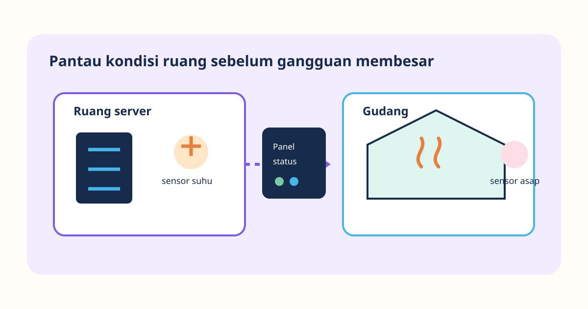
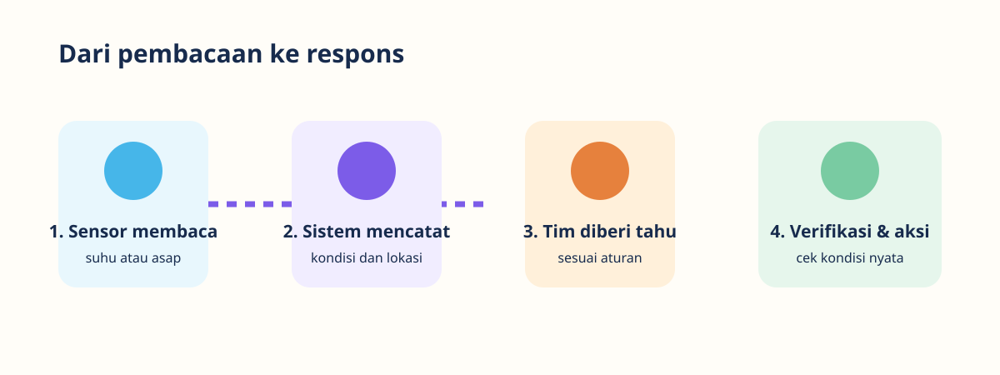
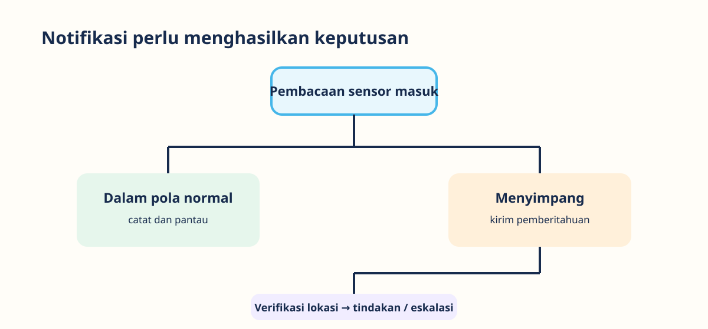
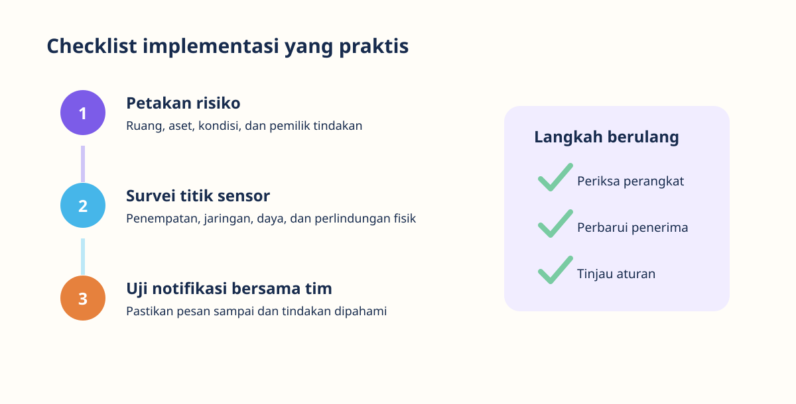

Ruang server dan gudang sering baru mendapat perhatian ketika gangguan sudah terasa: perangkat berhenti, stok terdampak, atau petugas menemukan kondisi tidak normal terlambat. Padahal, perubahan suhu, munculnya asap, atau pintu yang lama terbuka adalah sinyal yang layak terlihat lebih awal.

Monitoring suhu dan asap berbasis IoT membantu Anda mengumpulkan sinyal tersebut ke satu alur yang jelas. IoT berarti perangkat sensor mengirim pembacaan ke sistem melalui jaringan. Tujuannya bukan membuat ruang menjadi sepenuhnya otomatis, melainkan membantu orang yang tepat menerima informasi yang cukup untuk mengambil tindakan lebih cepat.

## Mulai dari risiko ruang, bukan dari daftar sensor

Di Kalimantan Timur, suhu dan kelembapan udara yang tinggi, serta listrik yang tidak selalu stabil, membuat pemeriksaan manual dengan termometer dinding mudah terlambat, terutama di luar jam kerja. Setiap lokasi punya risiko dan proses kerja berbeda. Ruang server kecil mungkin lebih membutuhkan pemantauan suhu, listrik, dan akses pintu. Gudang bisa membutuhkan perhatian pada area penyimpanan tertentu, jalur kerja, ventilasi, serta prosedur pemeriksaan keamanan yang sudah berlaku.

Sebelum memilih perangkat, petakan tiga hal berikut:

- Ruangan mana yang dampaknya paling besar bila kondisinya terganggu.
- Kondisi apa yang perlu diketahui lebih awal: suhu meningkat, asap terdeteksi, kelembapan, listrik putus, atau pintu terbuka.
- Siapa yang bertugas menerima notifikasi, memeriksa lokasi, dan mengeskalasi masalah.

Pemetaan ini mencegah pembelian sensor yang banyak tetapi tidak punya pemilik tindakan. Sistem yang berguna selalu menghubungkan sinyal dengan keputusan: *jika kondisi ini terjadi, siapa melakukan apa?*

## Alur sederhana dari sensor sampai tindakan

Sensor ditempatkan di titik yang sesuai, membaca kondisi lingkungan, lalu mengirimkannya ke aplikasi atau panel pemantauan. Sistem dapat mencatat perubahan dan mengirim notifikasi ketika kondisi melewati ambang yang telah Anda sepakati. Petugas kemudian memeriksa lokasi atau sumber masalah melalui prosedur yang ada.

Yang penting, notifikasi tidak boleh menjadi tujuan akhir. Notifikasi adalah pemicu verifikasi: cek kondisi nyata, nilai tingkat urgensi, lalu jalankan respons yang tepat.

Pada lokasi dengan beberapa sensor, satu tampilan bersama dapat memudahkan pengawas melihat mana yang normal, mana yang perlu diperiksa, dan mana yang sudah ditangani. [Layanan IoT custom](/services/iot-custom) dapat menjadi titik awal untuk membahas kebutuhan pemantauan sensor sesuai ruang dan alur operasional Anda; contohnya [pemantau ruang server dan gudang](/portofolio/iot-monitoring-gudang) yang pernah kami kerjakan.

## Tentukan ambang dan notifikasi dengan konteks operasional

Angka ambang tidak sebaiknya disalin begitu saja dari lokasi lain. Kondisi normal sebuah ruang dipengaruhi perangkat, ventilasi, jam operasional, kebiasaan membuka pintu, dan tata letak. Karena itu, lakukan masa pengamatan awal untuk memahami pola kondisi normal di lokasi sendiri.

Kemudian susun aturan yang mudah dipahami. Misalnya, pembacaan yang menyimpang dapat memicu pemberitahuan kepada petugas jaga; kondisi yang berlanjut atau semakin serius dapat diteruskan kepada penanggung jawab berikutnya. Bedakan antara peringatan untuk diperiksa dan kejadian yang memerlukan respons segera.

Hindari notifikasi untuk setiap perubahan kecil. Terlalu banyak pesan membuat orang terbiasa mengabaikannya. Lebih baik notifikasi membawa konteks yang membantu: lokasi sensor, jenis kondisi, waktu kejadian, dan petunjuk tindakan pertama. Pastikan pula ada jalur cadangan bila penerima utama tidak merespons.

## Penempatan, jaringan, dan daya menentukan hasil

Sensor yang baik tetapi ditempatkan di titik keliru tetap menghasilkan informasi yang menyesatkan. Beberapa titik yang lazim dipertimbangkan: bagian atas rak server tempat udara panas berkumpul, titik tertinggi gudang karena udara panas dan asap cenderung naik, serta area panel listrik utama untuk mendeteksi panas berlebih. Sensor tambahan di dekat keluaran pendingin dapat dipakai khusus untuk membaca kinerja AC, dan dibaca terpisah dari sensor suhu ruangan. Hindari memasang sensor suhu tepat di hembusan pendingin atau sangat dekat sumber panas tunggal bila tujuan Anda membaca kondisi ruang secara umum. Untuk asap, penempatan harus mengikuti rancangan keselamatan bangunan dan perangkat yang digunakan; jangan menganggap sensor IoT pengganti sistem proteksi kebakaran yang diwajibkan atau prosedur darurat di lokasi Anda.

Tinjau juga kondisi lapangan:

- Ketersediaan jaringan pada titik sensor dan cara perangkat tetap mencatat data (*data logging*) lalu mengirimnya saat jaringan bermasalah.
- Sumber daya listrik, cadangan daya (misalnya UPS untuk router dan gateway) bila diperlukan, serta cara memantau baterai perangkat nirkabel.
- Perlindungan fisik sensor dari benturan, debu, air, atau akses tidak berwenang.
- Akses pemasangan dan jadwal perawatan agar perangkat bisa diperiksa tanpa mengganggu operasi.

Jika data dari beberapa lokasi akan dipantau bersama, [layanan IoT custom](/services/iot-custom) dapat membantu merancang tampilan, notifikasi, dan alur tindak lanjut yang selaras dengan kebutuhan pengelola.

## Batasan yang perlu dipahami sejak awal

Monitoring memberi tanda, bukan diagnosis sempurna. Sensor suhu tidak otomatis menjelaskan penyebab kenaikan suhu. Deteksi asap dapat dipengaruhi lingkungan, kondisi perangkat, dan lokasi pemasangan. Data yang terlambat terkirim juga tidak sama dengan kondisi ruang yang pasti aman atau pasti bermasalah.

Karena itu, jangan menjadikan sistem ini satu-satunya pengaman. Tetapkan inspeksi rutin, uji perangkat, prosedur respons, dan jalur pelaporan insiden. Untuk risiko kebakaran atau keselamatan kerja, ikuti ketentuan bangunan dan arahan pihak yang berwenang. Sistem digital seharusnya memperkuat disiplin operasional, bukan menggantikannya.

Keandalan juga bergantung pada perawatan: sensor asap di area berdebu perlu dibersihkan agar tidak menurun kepekaannya atau memicu alarm palsu, sensor perlu dicek, konektivitas perlu dipantau, dan daftar penerima notifikasi perlu diperbarui ketika ada pergantian personel. Tanpa itu, panel yang terlihat rapi dapat menyembunyikan masalah yang belum tertangani.

## Checklist sebelum implementasi

Gunakan daftar ringkas ini untuk memulai pembahasan internal:

- Tetapkan ruang dan aset yang paling perlu dipantau.
- Catat kondisi yang ingin dideteksi serta tindakan pertama untuk masing-masing kondisi.
- Tentukan pemilik notifikasi, jalur eskalasi, dan jam tanggung jawab.
- Survei titik pemasangan, jaringan, daya, dan hambatan fisik.
- Jalankan uji notifikasi dengan petugas yang benar-benar akan merespons.
- Tulis prosedur singkat: verifikasi, tindakan, pencatatan, dan penutupan kejadian.
- Jadwalkan pemeriksaan perangkat dan peninjauan ambang secara berkala.

Sebelum memperluas cakupan, lakukan simulasi sederhana bersama petugas. Buat satu pembacaan uji, pastikan notifikasi diterima, minta penerima menemukan lokasi yang dimaksud, lalu catat apakah instruksi pertama cukup jelas. Latihan ini sering mengungkap detail yang tidak terlihat di layar: nama ruang yang membingungkan, nomor kontak yang sudah tidak aktif, atau akses lokasi yang terbatas. Perbaiki alur tersebut sebelum sistem dipakai sebagai bagian dari operasi harian.

Simpan pula catatan kejadian secara ringkas. Catatan tidak perlu rumit, tetapi sebaiknya memuat waktu, lokasi, kondisi yang terlihat, tindakan yang diambil, dan status akhir. Dari sana, tim dapat membedakan gangguan berulang, masalah penempatan sensor, atau aturan notifikasi yang perlu disesuaikan. Dengan cara ini, data sensor menjadi bahan perbaikan proses, bukan hanya deretan angka pada panel.

> Monitoring yang efektif bukan sekadar melihat data. Ia membuat kondisi ruang, orang yang bertanggung jawab, dan tindakan berikutnya terhubung dalam satu kebiasaan kerja.

Mulailah dari satu atau dua ruang paling kritis, uji alurnya bersama tim, lalu perluas berdasarkan kebutuhan nyata. Untuk memetakan sensor, panel, dan respons yang sesuai operasi Anda, [hubungi tim Altora](/contact).
