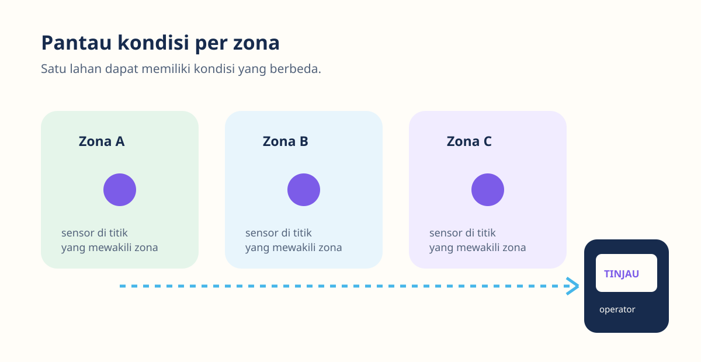
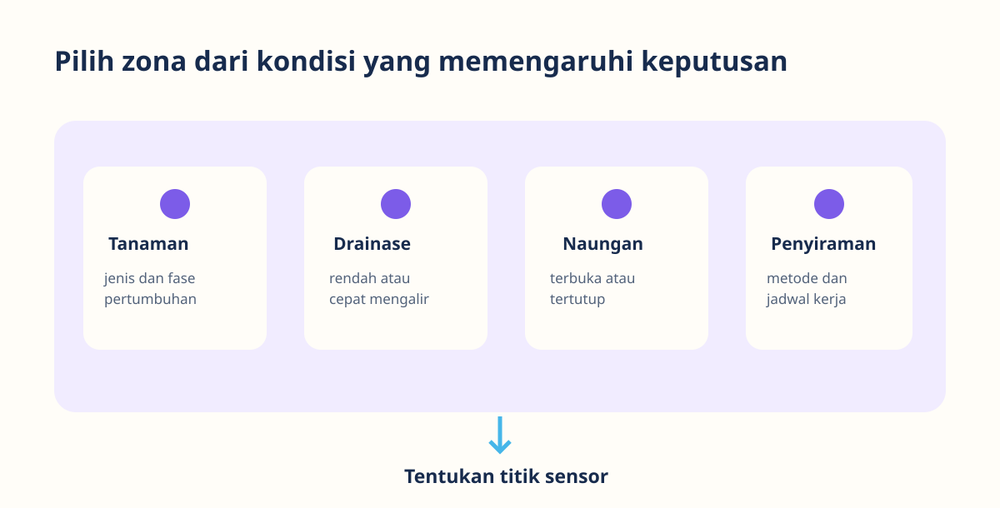
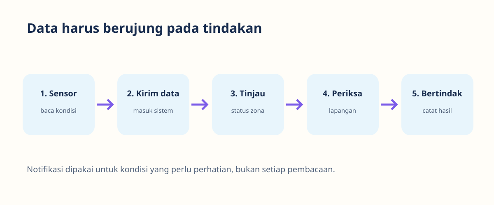
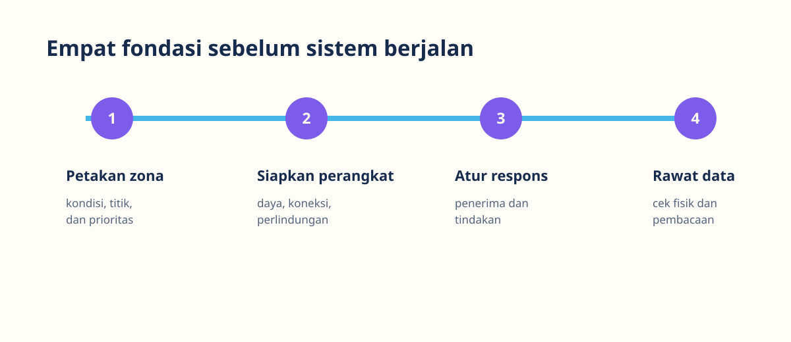

Kebun dan lahan tidak selalu membutuhkan penyiraman pada waktu yang sama. Kondisi tanah dapat berbeda antarblok, berubah setelah hujan, dan dipengaruhi jenis tanaman, naungan, serta kedalaman akar. Ketika keputusan hanya mengandalkan jadwal atau perkiraan dari permukaan tanah, air dan waktu kerja berisiko tidak dipakai pada titik yang tepat.

Di Kalimantan Timur, curah hujan yang tinggi tetapi tidak selalu merata, serta jenis tanah yang beragam, membuat permukaan yang tampak basah belum tentu menggambarkan kondisi di zona akar. Sensor kelembapan tanah membantu tim lapangan melihat kondisi media tanam sebagai satu masukan keputusan. Dalam *smart farming*, sensor mengirim pembacaan ke sistem sehingga operator dapat meninjau tren, memeriksa blok yang perlu perhatian, lalu menentukan tindakan. Ini bukan tombol otomatis yang langsung menyelesaikan semua masalah kebun; nilai utamanya ada pada keputusan yang lebih terarah.

## Apa yang sebenarnya diukur sensor kelembapan tanah

Sensor ditempatkan di tanah untuk membaca kondisi kelembapan pada lokasi dan kedalaman tertentu. Hasilnya kemudian dikirim melalui perangkat penghubung ke layar pemantauan atau notifikasi. Agar bermanfaat, pembacaan perlu diberi konteks: blok mana yang diukur, tanaman apa yang ada di sana, kapan terakhir disiram, dan apakah baru turun hujan.

Angka pada sensor bukan putusan tunggal untuk membuka pompa. Tim perlu menyepakati batas kerja berdasarkan pengamatan lahan dan kebutuhan tanaman. Pada awal penerapan, operator sebaiknya membandingkan pembacaan dengan pemeriksaan tanah langsung. Dengan begitu, sistem belajar menjadi alat bantu operasional, bukan angka yang dipercaya tanpa pemeriksaan.

## Tentukan masalah operasional sebelum memilih perangkat

Mulailah dari keputusan yang ingin diperbaiki, bukan dari daftar sensor. Contohnya: mandor sulit mengetahui blok mana yang lebih dahulu perlu diperiksa, penyiraman masih seragam padahal kondisi lahan berbeda, atau catatan kondisi tanah tersebar di chat dan buku lapangan.

Pertanyaan praktis berikut membantu memperjelas kebutuhan:

- Blok atau zona mana yang paling penting dipantau terlebih dahulu?
- Siapa yang menerima informasi dan siapa yang mengambil keputusan penyiraman?
- Apakah lokasi memiliki listrik, jaringan, atau perlu perangkat hemat daya?
- Apakah pembacaan akan menjadi alarm, laporan harian, atau bahan evaluasi mingguan?
- Apa tindakan petugas ketika data tidak masuk atau pembacaan tampak tidak wajar?

Untuk kebun kecil dengan satu pola penyiraman, inspeksi rutin dan catatan sederhana mungkin masih lebih tepat. Sistem sensor lebih masuk akal ketika area, variasi kondisi, atau frekuensi keputusan membuat pemeriksaan manual sulit konsisten.

## Rancang titik sensor berdasarkan zona, bukan sekadar luas lahan

Satu sensor tidak mewakili seluruh kebun. Tanah di area rendah dapat berbeda dari area terbuka; tanah dekat sumber air juga dapat memberi gambaran yang berbeda dari blok lain. Karena itu, pembagian zona adalah pekerjaan penting sebelum pemasangan.

Petakan blok berdasarkan kondisi yang memang memengaruhi keputusan: jenis tanaman, pola drainase, naungan, topografi, dan metode penyiraman. Pilih titik yang cukup mewakili tiap zona, lalu tentukan kedalaman pemasangan sesuai area perakaran yang ingin dipantau. Titik sensor juga perlu aman dari lalu-lalang alat, mudah diperiksa, dan diberi penanda agar tidak rusak saat pekerjaan lapangan.

Tampilan kondisi lahan per zona dapat dirancang lewat [IoT custom](/services/iot-custom) agar pembacaan sensor menyatu dengan aktivitas operasional. Sebagai gambaran implementasi lapangan, lihat [pemantau cuaca dan kelembapan lahan](/portofolio/iot-monitoring-lahan-sawit) di portofolio kami.

## Dari pembacaan ke tindakan harian

Alur yang baik harus singkat dan jelas. Sensor membaca kondisi, perangkat mengirim data, sistem menampilkan status per zona, lalu petugas melakukan pemeriksaan atau penyiraman sesuai aturan kerja. Notifikasi hanya perlu muncul bila ada kondisi yang memerlukan perhatian atau data berhenti masuk; terlalu banyak alarm justru membuat pesan penting diabaikan.

Buat aturan operasional yang mudah dijalankan:

1. Tetapkan siapa yang mengecek ringkasan kondisi pada waktu kerja tertentu.
2. Tandai zona yang memerlukan inspeksi lapangan, bukan langsung menganggap sensor salah atau benar.
3. Catat tindakan yang diambil, misalnya penyiraman, pemeriksaan pompa, atau pengecekan drainase.
4. Tinjau tren berkala untuk melihat apakah pola penyiraman dan kondisi tanah semakin selaras.

Data kelembapan juga dapat membantu menimbang waktu pemupukan, misalnya menunda pemupukan saat tanah sangat basah karena unsur hara dapat tercuci, dan riwayat data berguna untuk membandingkan pola antarmusim. Jika penyiraman ingin diotomatisasi, tambahkan pengaman: batas waktu, prosedur manual, pengecekan pompa, serta aturan saat jaringan putus. Otomasi tanpa rencana gagal justru dapat membuat risiko baru.

## Perawatan menentukan apakah data tetap bisa dipercaya

Perangkat di lahan menghadapi panas, hujan, lumpur, hewan, aktivitas pekerja, dan gangguan jaringan. Sumber daya juga perlu direncanakan; panel surya kecil sering dipakai di lokasi tanpa listrik, dan jangkauan komunikasi perlu dicek di blok yang paling jauh. Pemasangan bukan akhir pekerjaan. Jadwalkan pemeriksaan fisik sensor dan kabel, cek catu daya, bersihkan komponen sesuai petunjuk perangkat, serta bandingkan pembacaan dengan kondisi nyata bila muncul nilai yang mencurigakan.

Data juga perlu diawasi. Pembacaan yang mendadak datar, hilang terus-menerus, atau berubah tidak lazim perlu ditelusuri: apakah sensor berpindah, koneksi terganggu, daya habis, atau kondisi tanah memang berubah. Catatan gangguan membuat tim tidak mengulang diagnosis dari nol setiap kali ada masalah.

Libatkan pekerja lapangan sejak awal. Mereka mengetahui titik yang sering tergenang, jalur alat, dan kebiasaan penyiraman yang tidak terlihat pada peta. Masukan ini membantu memilih lokasi yang aman sekaligus relevan. Saat hasil monitoring dibahas bersama, tim juga lebih mudah membedakan data yang perlu diperiksa dari kondisi yang memang sudah mereka kenali.

Mulai dari cakupan yang dapat dikelola. Uji alur pada beberapa zona prioritas, pastikan data sampai dan respons petugas berjalan, lalu evaluasi sebelum menambah titik lain. Pendekatan bertahap memberi ruang untuk memperbaiki penempatan sensor, aturan notifikasi, dan prosedur perawatan tanpa membebani operasi harian.

## Checklist sebelum memulai

- Petakan zona lahan dan keputusan yang ingin dibantu.
- Tentukan titik, kedalaman, perlindungan fisik, daya, dan konektivitas.
- Sepakati penerima notifikasi serta tindakan untuk setiap kondisi penting.
- Jalankan masa pembandingan antara pembacaan sensor dan inspeksi lapangan.
- Buat jadwal pemeriksaan perangkat, koneksi, dan kualitas data.
- Siapkan prosedur manual saat sensor, jaringan, atau pompa bermasalah.

Sensor kelembapan tanah paling berguna saat menjadi bagian dari kebiasaan kerja: data dibaca, kondisi lapangan diperiksa, lalu tindakan dicatat dan dievaluasi. Dengan rancangan zona dan alur respons yang tepat, smart farming dapat membuat perhatian tim tertuju pada bagian lahan yang benar-benar perlu ditangani.

Jika Anda ingin memetakan kebutuhan monitoring kebun atau lahan, [hubungi tim Altora](/contact) untuk membahas alur yang sesuai dengan kondisi operasional Anda.
