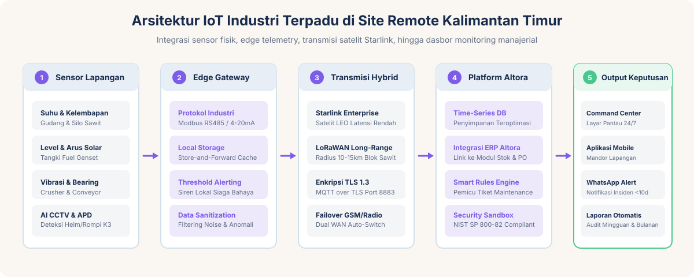
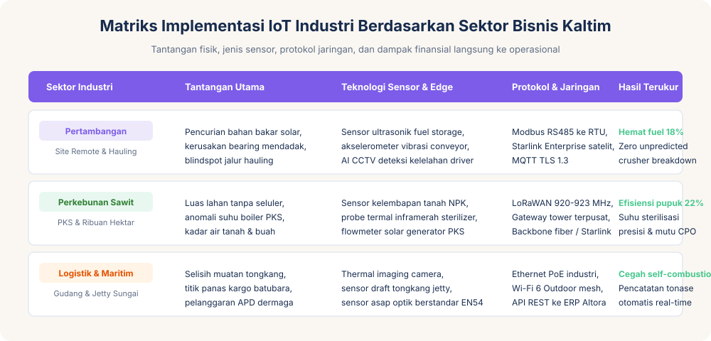
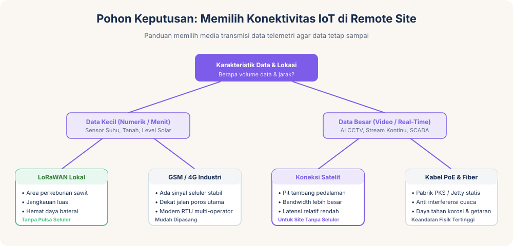
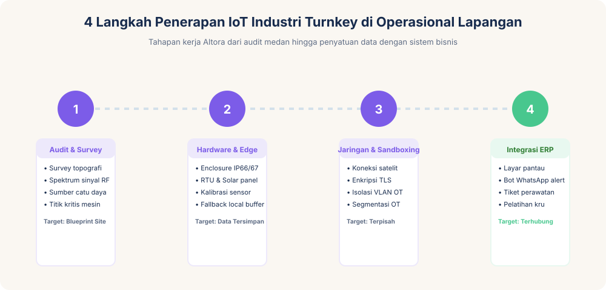

Operasi industri skala besar di Kalimantan Timur, dari konsesi tambang batubara di Kutai Kartanegara dan Kutai Timur, perkebunan sawit di Berau dan Paser, sampai kawasan logistik pelabuhan di Balikpapan dan Samarinda, berjalan di medan yang menantang. Jarak antarblok kerja jauh, jalan tanah licin saat hujan, dan sinyal seluler tidak selalu tersedia, sehingga kantor pusat sering kehilangan gambaran langsung tentang kondisi di lapangan.

Ketika pengawasan masih bergantung pada laporan kertas atau spreadsheet berkala, masalah baru terlihat setelah terlambat: solar alat berat yang tidak cocok dengan jam kerja, bearing yang aus tanpa tanda, atau suhu proses yang bergeser tanpa terdeteksi. IoT industri membantu dengan memasang sensor di titik krusial, mengolah data awal di perangkat lokal (*edge*), mengirimkannya ke pusat, lalu menampilkan hasilnya sebagai notifikasi dan dashboard.

Artikel ini membahas arsitektur yang lazim, penerapannya di tiga sektor, cara memilih konektivitas untuk site tanpa sinyal, dan cara menghubungkan data sensor ke proses bisnis. Seluruhnya adalah panduan perencanaan; hasil nyata bergantung pada kondisi site dan disiplin operasional.

## Arsitektur IoT industri untuk site terpencil

Perangkat di site terpencil harus tahan debu, lumpur, getaran, dan petir yang umum di pedalaman Kalimantan, sehingga standar ketahanannya berbeda dari otomasi gedung perkotaan. Altora merancang IoT custom dengan lima lapisan berikut, disesuaikan per proyek:

1. **Sensor lapangan.** Instrumen industri dengan perlindungan debu dan air yang sesuai lokasi, serta keluaran seperti 4-20 mA, digital, atau Modbus RS-485 yang lebih tahan gangguan.
2. **Edge gateway.** Perangkat lokal yang menyaring data, memeriksa ambang peringatan, dan menyimpan data sementara (*store-and-forward*) bila koneksi keluar terputus.
3. **Jaringan transmisi.** Kombinasi LoRaWAN untuk sensor di area luas dan koneksi satelit atau seluler untuk menghubungkan site ke server.
4. **Platform data dan aturan.** Basis data deret waktu dan aturan notifikasi yang dapat dihubungkan ke sistem lain, misalnya stok atau perawatan aset.
5. **Pusat kendali.** Dashboard, aplikasi untuk mandor, dan notifikasi lewat WhatsApp bila ada kondisi yang perlu ditindaklanjuti.

Jaringan operasional perlu dipisahkan dari jaringan umum dengan segmentasi yang jelas, dan lalu lintas data sebaiknya dienkripsi (misalnya MQTT melalui TLS). Terapkan juga hak akses berbasis peran pada dashboard.

## Tiga sektor industri yang paling sering membutuhkan IoT di Kaltim

Setiap sektor punya titik rawan sendiri. Prinsipnya sama: pilih satu atau dua masalah yang paling merugikan, pasang sensor di sana, lalu buktikan alurnya sebelum diperluas.

### Pertambangan batubara dan hauling

Bahan bakar solar merupakan komponen biaya yang besar pada operasi tambang. Sensor level pada tangki penyimpanan dan unit dapat mencatat pengisian serta konsumsi, lalu membandingkannya dengan jam kerja mesin; selisih yang tidak wajar dapat ditandai untuk diperiksa. Pada conveyor dan crusher, sensor getaran dapat membantu mendeteksi perubahan kondisi bantalan lebih awal sehingga penggantian dapat dijadwalkan, bukan menunggu rusak. Untuk armada, lihat juga [fleet management untuk logistik dan tambang](/blog/fleet-management-logistik-tambang).

### Perkebunan dan pabrik kelapa sawit

Di lahan yang luas, sensor kelembapan tanah dan stasiun cuaca mikro yang terhubung lewat LoRaWAN dapat mengirim kondisi lahan secara berkala tanpa petugas berkeliling. Panduan rincinya ada di [sensor kelembapan tanah untuk smart farming](/blog/smart-farming-sensor-tanah), dan contoh pekerjaannya di [pemantau cuaca dan kelembapan lahan](/portofolio/iot-monitoring-lahan-sawit). Di pabrik, sensor suhu dan tekanan pada proses seperti sterilizer membantu operator menjaga proses tetap berada dalam batas yang ditetapkan pabrik.

### Logistik maritim, tongkang, dan jetty

Aktivitas angkut di Sungai Mahakam dan Teluk Balikpapan memerlukan pencatatan muatan dan posisi yang tertib. Sensor dan GPS dapat membantu pencatatan, dan pada area stockpile, kamera termal dapat dipertimbangkan untuk menandai titik panas. Contoh komunikasi dan pelacakan armada air ada di [GPS armada dan radio marine VHF](/portofolio/fleet-radio-kapal). Untuk sisi administrasinya, baca [integrasi ERP untuk logistik maritim](/blog/integrasi-erp-logistik-maritim-kaltim).

## Memilih konektivitas di site tanpa sinyal seluler

Tantangan terbesar di pedalaman adalah tidak adanya fiber dan menara seluler. Salah memilih media membuat data terputus atau perangkat cepat kehabisan daya. Gunakan pertimbangan berikut:

- **LoRaWAN.** Cocok untuk data kecil (suhu, kelembapan tanah, status pintu) pada area luas. Perangkat hemat daya sehingga baterainya dapat bertahan lama, dan jangkauannya bergantung pada medan serta penempatan gateway.
- **Satelit LEO.** Pilihan untuk kantor site, pit, atau kapal tanpa seluler, termasuk bila data telemetri perlu berbagi jalur dengan video CCTV. Layanan seperti Starlink dibeli dari penyedianya; Altora bukan mitra resmi Starlink dan membantu memadukannya ke sistem IoT sesuai kebutuhan proyek.
- **Seluler 4G industri.** Untuk area yang sudah terjangkau sinyal operator, dengan modem yang dapat berpindah operator bila perlu. Cek kekuatan sinyal di titik pemasangan.
- **Kabel RS-485 atau Ethernet industri.** Untuk lingkungan stasioner dengan gangguan elektromagnetik tinggi, seperti workshop alat berat atau ruang genset.

Untuk perangkat jaringan, satelit, dan GPS yang tersedia, lihat [pengadaan jaringan](/pengadaan#jaringan) dan [pengadaan GPS](/pengadaan#gps).

## Menghubungkan data sensor ke proses bisnis

Data sensor yang hanya berhenti di grafik jarang mengubah apa pun. Nilainya muncul ketika kondisi tertentu memicu tindakan. Contohnya, bila suhu ruang genset melewati ambang yang disepakati selama waktu tertentu, sistem dapat mengirim pesan ke supervisor, membuat tiket perawatan, dan mengingatkan pengecekan ketersediaan suku cadang. Integrasi seperti ini dirancang bertahap melalui [software custom](/services/software-custom), dimulai dari satu alur yang jelas pemiliknya, bukan semua proses sekaligus.

## Empat langkah menerapkan IoT industri

Inisiatif digitalisasi sering terhenti karena vendor sensor tidak mengerti pemrograman server, sementara penyedia software tidak mengerti instalasi lapangan. Pendekatan bertahap berikut membantu menjaganya tetap utuh:

1. **Survei dan audit.** Kunjungi site untuk memetakan titik sensor, sumber daya listrik, kondisi sinyal, dan titik kritis mesin.
2. **Perangkat keras dan edge.** Siapkan panel dan enclosure yang sesuai cuaca, catu daya (termasuk panel surya bila perlu), perlindungan petir, kalibrasi sensor, dan penyimpanan lokal.
3. **Jaringan dan keamanan.** Bangun jalur komunikasi, enkripsi, dan segmentasi jaringan operasional.
4. **Dashboard dan pelatihan.** Pasang dashboard di ruang kendali, hubungkan notifikasi ke personel, dan latih teknisi agar mampu merawat sistem secara mandiri.

Mulailah dari satu site atau satu masalah, ukur hasilnya bersama tim operasi, lalu perluas. Bila Anda ingin memetakan kebutuhan IoT di site Anda, lihat [layanan IoT custom](/services/iot-custom) atau [hubungi tim Altora](/contact).
