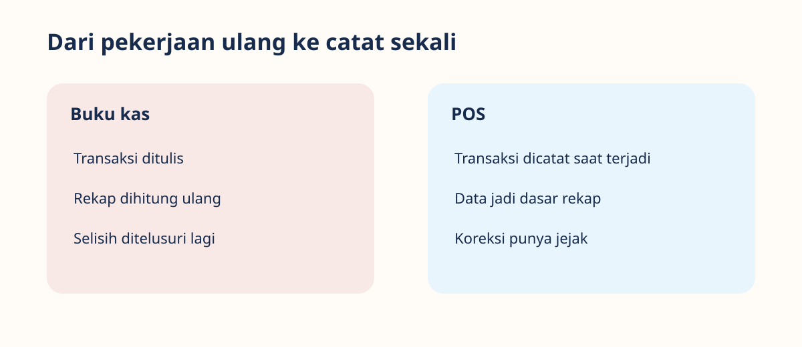
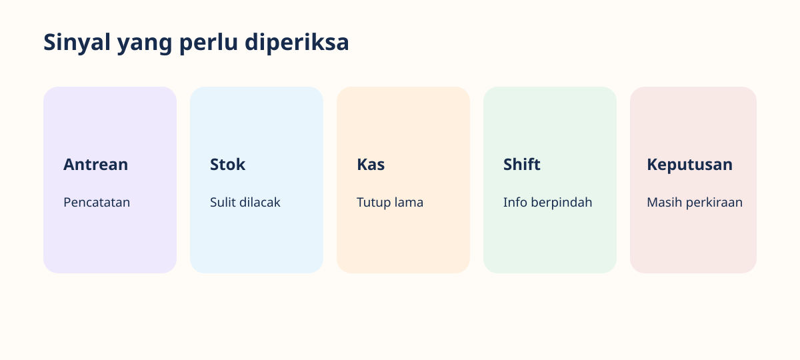
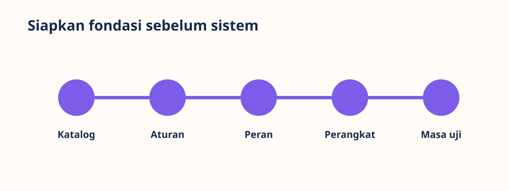
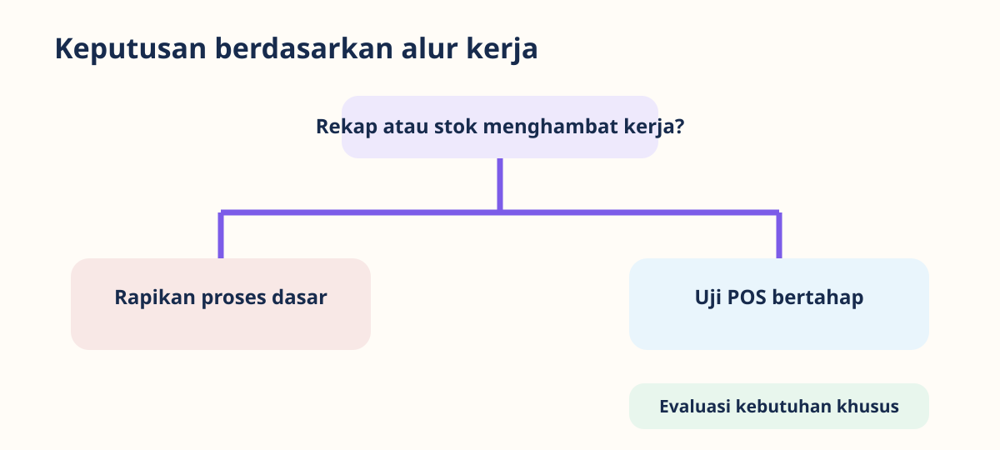

Buku kas masih dapat membantu ketika transaksi sedikit, jenis barang sederhana, dan pemilik selalu berada di lokasi. Namun ketika antrean mulai muncul, stok sulit dipercaya, atau Anda perlu bertanya berulang kali kepada kasir untuk mengetahui penjualan hari ini, masalahnya bukan lagi sekadar format pencatatan. Alur kerja bisnis sudah melampaui kemampuan buku tulis.

Sistem POS (*point of sale*) membantu kasir mencatat transaksi saat penjualan terjadi. Dalam bentuk yang tepat, POS juga menghubungkan transaksi dengan produk, stok, metode pembayaran, dan laporan yang perlu dilihat pemilik. Ini bukan alasan untuk mengejar aplikasi yang rumit; tujuannya mengurangi pekerjaan ulang dan membuat keputusan harian memakai catatan yang lebih rapi. Pola ini lazim ditemui pada kedai kopi, toko kelontong, dan usaha retail di Balikpapan, Samarinda, dan kota lain di Kalimantan Timur.

Artikel ini membantu Anda mengenali kapan perpindahan dari buku kas masuk akal, apa yang perlu dipersiapkan, serta batasan POS agar pembelian perangkat atau sistem tidak menjadi beban baru.

## Buku kas mulai mahal ketika pekerjaan harus diulang

Masalah buku kas jarang terlihat pada satu transaksi. Masalahnya muncul saat data yang sama harus ditulis, dihitung, diperiksa, lalu dicocokkan lagi. Kasir mencatat penjualan. Pemilik menjumlahkan uang. Stok dihitung pada waktu lain. Jika ada selisih, semua pihak menelusuri catatan yang mungkin tidak seragam.

Perhatikan sinyal berikut:

- Rekap harian tertunda karena kasir harus menghitung ulang nota atau catatan.
- Harga, diskon, atau nama barang sering ditanyakan atau ditulis berbeda.
- Stok baru diketahui habis saat pelanggan sudah meminta barang.
- Selisih kas sulit ditelusuri ke transaksi, pengembalian, atau perubahan harga tertentu.
- Pemilik tidak bisa melihat gambaran penjualan tanpa hadir di toko atau menunggu laporan manual.
- Ada lebih dari satu kasir, shift, atau lokasi sehingga penyerahan informasi menjadi rentan salah paham.

Satu tanda belum tentu menuntut POS. Namun bila beberapa tanda berulang setiap minggu, waktu orang sudah dipakai untuk memperbaiki administrasi, bukan melayani pelanggan atau mengatur pertumbuhan usaha. Pada kondisi itu, sistem sederhana yang sesuai alur kerja biasanya lebih bernilai daripada menambah lembar buku baru.

## Apa yang seharusnya dibenahi oleh POS

POS yang relevan untuk usaha Anda harus menjawab alur transaksi nyata. Kasir memilih barang atau layanan, sistem menerapkan harga yang sudah disiapkan, pembayaran dicatat, dan bukti transaksi tersedia. Setelah itu, catatan penjualan dapat menjadi dasar rekap, bukan bahan untuk mengetik ulang.

Untuk bisnis dengan persediaan, pengurangan stok perlu mengikuti barang yang terjual. Untuk bisnis jasa, yang penting mungkin daftar layanan, petugas, jadwal, atau status pembayaran. Kebutuhan tiap usaha berbeda. Karena itu, mulailah dari aktivitas yang paling sering dilakukan, bukan dari daftar fitur terpanjang.

[Altora Store](/aplikasi/store) dapat menjadi titik awal untuk membahas alur penjualan, kasir, stok, dan pencatatan yang perlu Anda rapikan; ada demo yang bisa dicoba. Jika transaksi nantinya perlu tersambung dengan proses operasional yang lebih luas, [software custom](/services/software-custom) perlu dirancang bertahap agar data yang masuk tetap konsisten.

> Prinsipnya sederhana: satu transaksi sebaiknya dicatat sekali, oleh orang yang menjalankannya, pada saat kejadian berlangsung.

## Lima kondisi yang membuat perpindahan layak diprioritaskan

### 1. Antrean dan pencatatan saling mengganggu

Saat pelanggan menunggu, kasir cenderung mempercepat proses dengan hafalan, catatan sementara, atau penundaan input. Ini menciptakan utang administrasi di akhir shift. POS cocok bila layar kasir dapat membuat pilihan barang dan pembayaran lebih jelas daripada menulis manual. Uji dulu dengan daftar produk yang pendek dan tombol yang mudah dibaca; kecepatan tidak datang dari layar yang ramai.

### 2. Stok adalah sumber pertanyaan harian

Jika tim sering menjawab “coba cek gudang dulu”, Anda memerlukan disiplin data sebelum mengharapkan stok otomatis. Buat nama barang, satuan, dan aturan penerimaan barang yang konsisten. POS dapat membantu transaksi keluar tercatat, tetapi tidak dapat mengetahui barang masuk, barang rusak, atau pengambilan internal bila proses tersebut tidak dicatat.

### 3. Penutupan kas memakan terlalu banyak energi

Tutup kas yang baik bukan hanya total uang di laci. Anda perlu membedakan pembayaran tunai dan non-tunai, transaksi batal, pengembalian, serta perubahan harga yang disetujui. POS dapat menyediakan jejak transaksi; tetap tetapkan siapa yang berhak membatalkan atau mengubah transaksi. Kontrol akses ini penting, terutama saat pemilik tidak selalu di lokasi.

### 4. Usaha mulai memiliki shift atau cabang

Semakin banyak orang yang menyentuh proses penjualan, semakin lemah andalan “nanti saya jelaskan”. Sistem membantu menyamakan katalog, harga, dan format laporan. Tetapi cabang tidak otomatis rapi hanya karena memakai aplikasi yang sama. Tentukan dahulu siapa pemilik data produk, kapan stok dipindahkan, dan bagaimana koreksi dilakukan.

### 5. Keputusan pembelian perlu bukti, bukan perkiraan

Produk yang tampak laku belum tentu paling menguntungkan, dan hari ramai belum tentu berarti kas sesuai. Dengan transaksi yang dicatat lebih terstruktur, Anda dapat mengajukan pertanyaan yang sebelumnya sulit dijawab: barang apa yang paling sering terjual, kapan jam sibuk, dan di mana perlu pengecekan. Gunakan laporan untuk menemukan pertanyaan operasional; jangan menganggap angka di layar sebagai kebenaran tanpa proses input yang rapi. Bagi pemilik yang memiliki lebih dari satu outlet atau sering bepergian, catatan yang masuk langsung ke sistem juga mengurangi ketergantungan pada foto nota dan rekap yang dikirim lewat chat, selama disiplin input terjaga.

## Yang perlu disiapkan sebelum memilih sistem

Jangan langsung memindahkan semua kebiasaan lama ke aplikasi. Rapikan fondasinya dahulu. Proses ini juga menghindari implementasi yang terasa gagal padahal data awalnya tidak siap.

1. **Daftar produk atau layanan.** Putuskan nama, harga, kategori, dan satuan yang dipakai semua orang.
2. **Aturan transaksi.** Tentukan perlakuan diskon, transaksi batal, retur, utang pelanggan bila ada, dan pembulatan.
3. **Peran pengguna.** Pisahkan hak kasir, supervisor, dan pemilik. Tidak semua orang perlu boleh mengubah harga atau melihat seluruh laporan.
4. **Perangkat dan koneksi.** Tentukan apakah Anda membutuhkan printer struk, [pemindai barcode atau QR code](/blog/barcode-vs-qr-code-kasir-gudang), perangkat kasir, serta prosedur bila koneksi bermasalah. Untuk komputer atau perangkat kasir, lihat [pengadaan komputer dan perangkat](/pengadaan#komputer).
5. **Masa uji.** Mulai dari satu titik kasir atau satu kelompok produk. Bandingkan proses penutupan kas dan stok sebelum memperluas penggunaan.

Checklist singkat sebelum Anda memutuskan:

- Transaksi sudah cukup sering sehingga rekap manual mengganggu pekerjaan utama.
- Ada orang yang bertanggung jawab atas katalog, harga, dan koreksi data.
- Aturan kas dan stok dapat dijelaskan kepada tim dalam bahasa sederhana.
- Perangkat dipilih berdasarkan alur kasir, bukan sekadar spesifikasi tertinggi.
- Anda siap melatih tim dan mengecek penggunaan pada minggu-minggu awal.

## POS bukan obat untuk semua masalah operasi

POS tidak menggantikan pemeriksaan stok fisik, persetujuan pengeluaran, atau pelatihan kasir. Bila harga berubah tanpa prosedur, barang masuk tidak dicatat, atau akun dipakai bergantian, laporan akan ikut kacau. Sistem hanya mempercepat proses yang Anda jalankan—termasuk proses yang buruk.

Usaha yang transaksi hariannya masih sangat sedikit dan produknya sederhana mungkin belum perlu sistem POS penuh. Mulailah dengan format pencatatan yang lebih disiplin, katalog yang rapi, serta prosedur tutup kas. Ketika volume, shift, atau kebutuhan laporan bertambah, Anda sudah memiliki fondasi yang lebih mudah dipindahkan ke sistem.

Untuk kebutuhan yang tidak berhenti di kasir—misalnya alur persetujuan khusus, integrasi perangkat, atau proses yang berbeda dari usaha pada umumnya—jangan memaksakan sistem siap pakai. Nilai kebutuhan tersebut dibandingkan dengan proses yang benar-benar ingin dihemat.

## Ringkasan keputusan

Pilih POS bila masalah utama Anda adalah transaksi berulang, rekap terlambat, stok yang tidak mudah dilacak, atau kontrol kas lintas orang dan shift. Tunda dulu bila proses dasar masih berubah setiap hari dan belum ada yang bertanggung jawab atas data produk serta aturan koreksi.

Langkah paling aman adalah memetakan satu hari transaksi dari pelanggan datang sampai kas ditutup, lalu menandai bagian yang ditulis ulang atau paling sering memicu selisih. Dari peta itu, kebutuhan POS akan jauh lebih jelas daripada memilih berdasarkan iklan fitur.

Jika Anda ingin memetakan alur penjualan dan kebutuhan sistem yang paling masuk akal untuk usaha Anda, [hubungi tim Altora](/contact).
