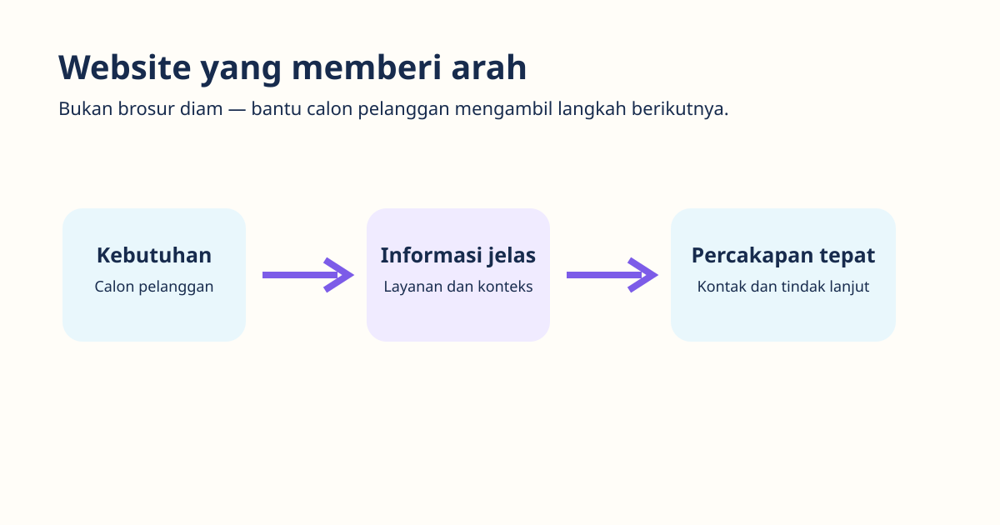
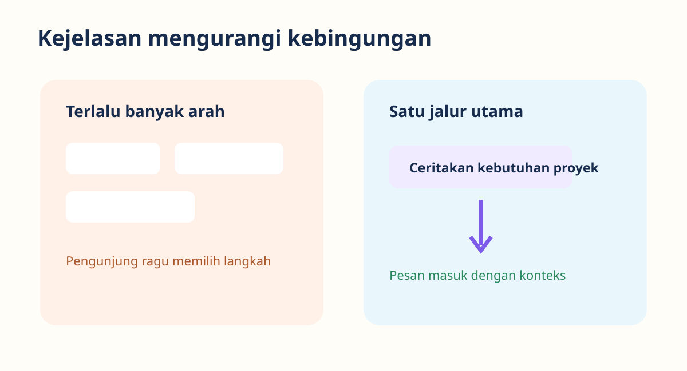
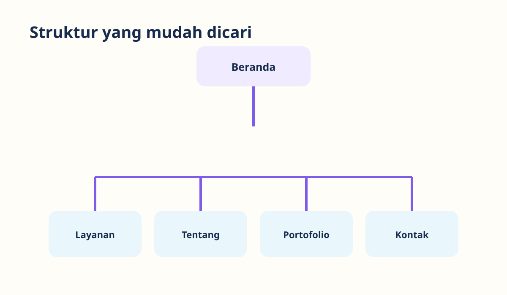
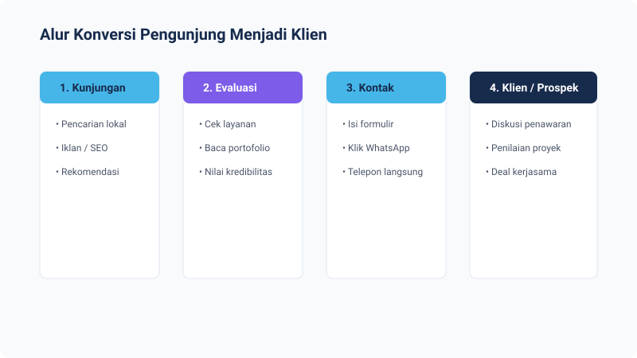
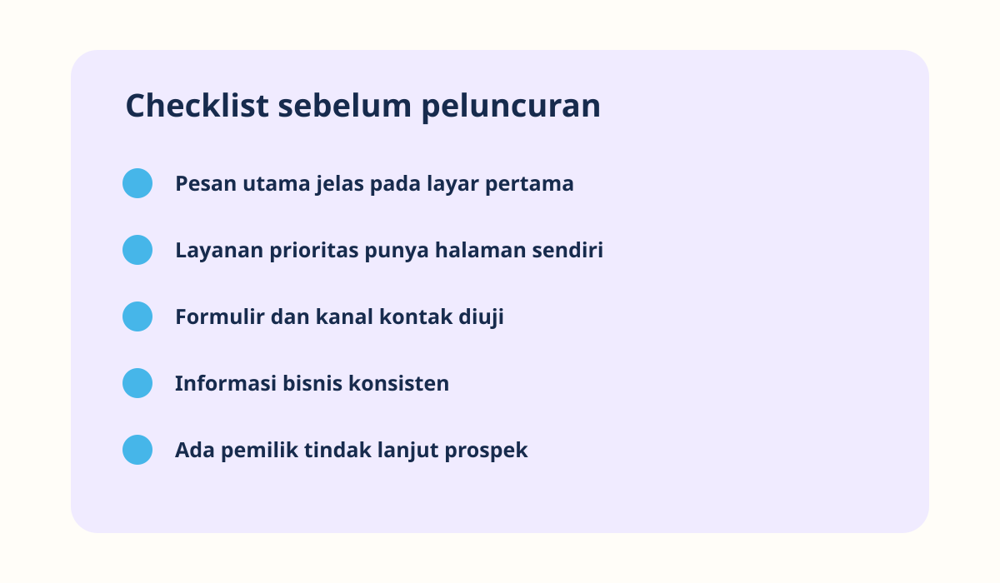

*Website company profile* bukan sekadar kartu nama digital. Bagi pelaku usaha, kontraktor, dan penyedia jasa di Kalimantan Timur, website sering menjadi tempat pertama calon klien, mitra, dan instansi memeriksa apakah bisnis Anda profesional dan siap menerima proyek. Namun, banyak website tampak rapi tetapi tidak membuat calon klien mengambil langkah berikutnya, yaitu menghubungi Anda.

Masalahnya sering terletak pada orientasi: website disusun mengikuti selera tampilan, bukan struktur informasi yang dicari pengambil keputusan. Calon klien B2B atau instansi tidak punya banyak waktu untuk membaca sejarah perusahaan yang panjang di halaman utama atau mengagumi animasi grafis yang berlebihan. Mereka ingin segera tahu apa solusi yang Anda tawarkan, bukti pengalaman kerja di lapangan, serta bagaimana cara menghubungi tim Anda dengan cepat dan efisien tanpa hambatan navigasi.

Melalui artikel ini, kita akan membedah struktur halaman wajib, elemen persuasi yang efektif, serta kesalahan umum yang membuat sebuah *website* perusahaan sepi dari prospek bisnis yang nyata. Dengan struktur yang tepat, website dapat menjadi saluran yang rutin mendatangkan percakapan dengan calon klien, meski hasilnya tetap bergantung pada penawaran, kualitas bukti kerja, dan ketekunan tindak lanjut.

## 1. Halaman Utama yang Menjawab Kebutuhan sejak Layar Pertama

Halaman utama adalah gerbang pertama yang menentukan apakah pengunjung bertahan atau menutup tab. Pengunjung harus langsung memahami tiga hal krusial begitu halaman terbuka: apa bidang usaha Anda, siapa segmen yang Anda layani, dan apa alasan utama mereka harus memilih perusahaan Anda dibandingkan kompetitor. Hindari kalimat pembuka yang terlalu puitis atau filosofis yang tidak menjelaskan produk secara konkret.

Gunakan tajuk utama (*headline*) yang jelas, lugas, dan berfokus pada solusi atas masalah utama klien Anda di wilayah lokal seperti Samarinda, Balikpapan, dan sekitarnya. Di bawah tajuk utama, letakkan satu tombol aksi (*Call to Action* atau CTA) utama yang kontras dan mengarah langsung ke halaman kontak atau konsultasi proyek. Susunan visual yang bersih dengan *whitespace* yang memadai akan membuat pengunjung merasa nyaman dan langsung menangkap profesionalisme brand Anda.

## 2. Struktur Menu Layanan yang Spesifik dan Berbasis Masalah

Kesalahan klasik dalam merancang *website company profile* adalah membuat halaman layanan yang digabung secara samar atau menggunakan istilah internal perusahaan yang asing bagi calon klien. Klien mencari solusi atas masalah spesifik yang sedang mereka hadapi saat ini, bukan struktur organisasi birokratis Anda. Oleh karena itu, pisahkan setiap lini jasa atau produk ke dalam halaman penjelasan yang mendalam, terstruktur, dan mudah dipahami oleh orang awam maupun pengambil keputusan.

Setiap halaman layanan wajib memuat penjelasan singkat mengenai ruang lingkup pekerjaan, proses pelaksanaan, serta jenis industri yang pernah dilayani. Sebagai contoh, bila Anda menawarkan beberapa layanan, pastikan masing-masing punya halaman sendiri. Untuk gambaran struktur halaman layanan, lihat [website dan SEO](/services/website-seo) serta [pembuatan website di Samarinda](/jasa-pembuatan-website-samarinda); agar website mudah ditemukan, baca juga [layanan SEO](/services/seo).

## 3. Portofolio dan Bukti Kerja Nyata di Lapangan

Kepercayaan adalah mata uang utama dalam dunia bisnis, terutama di sektor industri, konstruksi, dan pengadaan di Kalimantan. Klaim bahwa perusahaan Anda "berpengalaman dan terpercaya" tidak memiliki nilai di mata klien baru tanpa adanya bukti portofolio yang dapat diverifikasi secara objektif. Tampilkan dokumentasi proyek nyata, studi kasus penyelesaian masalah, atau daftar wilayah operasional tempat Anda pernah menyelesaikan pekerjaan dengan sukses.

Jika memungkinkan, sertakan ringkasan tantangan proyek yang dihadapi klien sebelumnya dan bagaimana solusi dari perusahaan Anda berhasil mengatasinya. Hindari foto stok generik yang tampak tidak nyata karena dapat menurunkan kepercayaan calon mitra. Sebagai contoh website yang kami kerjakan, lihat [website FEB Unmul](/portofolio/website-feb-unmul) dan [website Farmasi Unmul](/portofolio/website-farmasi-unmul).

## 4. Halaman Kontak yang Transparan dan Jalur Komunikasi Langsung

Ironisnya, banyak *website* perusahaan komersial gagal menghasilkan prospek hanya karena halaman kontak mereka disembunyikan di menu paling bawah atau menggunakan formulir rumit yang sering kali mengalami kendala teknis saat dikirimkan. Sediakan berbagai alternatif jalur komunikasi yang mudah diakses, mulai dari nomor telepon resmi, alamat kantor fisik yang jelas di wilayah Kalimantan, hingga alamat email korporat yang aktif dipantau setiap hari kerja.

Untuk memudahkan calon klien berkonsultasi, sediakan tombol WhatsApp atau formulir singkat yang hanya meminta data esensial seperti nama, instansi, dan ringkasan kebutuhan proyek. Semakin sedikit hambatan bagi calon klien untuk menghubungi Anda, semakin tinggi pula peluang konversi kunjungan *website* menjadi prospek bisnis yang berharga.

## Checklist struktur halaman website company profile

- **Hero Section:** Tajuk utama yang menjelaskan solusi, sub-teks pendukung, dan satu tombol CTA utama.
- **Halaman Layanan:** Penjelasan spesifik per lini jasa dengan navigasi yang bersih dan transparan.
- **Portofolio Proyek:** Dokumentasi pekerjaan nyata, studi kasus, dan wilayah jangkauan operasional.
- **Informasi Kontak:** Alamat fisik kantor, nomor telepon resmi, dan formulir komunikasi yang ringkas.

Membangun *website company profile* yang produktif dan menghasilkan prospek berkualitas membutuhkan keseimbangan antara kejelasan informasi, struktur navigasi yang logis, dan fokus pada kebutuhan nyata calon klien. Dengan membenahi arsitektur informasi secara bertahap, website tidak lagi hanya pajangan, tetapi alat yang membantu memperluas jangkauan pasar di Kalimantan dan sekitarnya.

Jika Anda ingin merapikan website perusahaan agar lebih jelas bagi calon klien, [hubungi tim Altora](/contact). Untuk memilih mitra pengembangan, baca juga [cara memilih software house](/blog/cara-memilih-software-house-samarinda-balikpapan).
